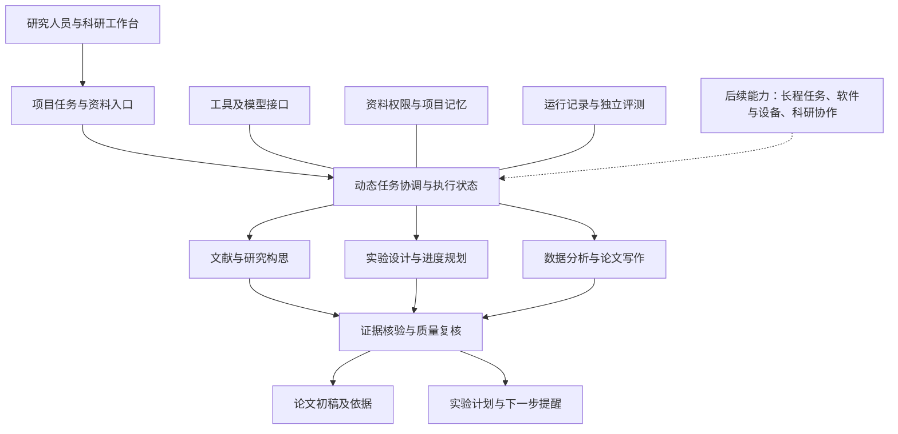
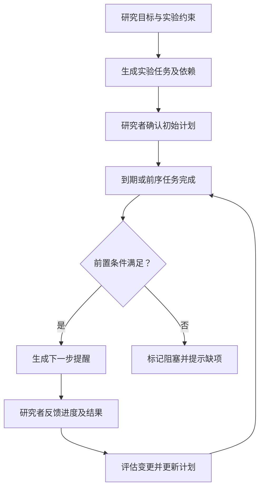

# 研枢平台总体技术架构

版本 V1｜面向建设与汇报；图中为目标能力，未表示已经实现。

## 1. 总体架构图

科研人员在工作台查看任务、资料、论文、实验计划和提醒。任务协调根据目标、状态与条件选择专业能力；复核决定交付、补资料、定点修复或提请人工判断。来源、权限、状态和评测贯穿两条路线。

## 2. 按职责组织

| 组成 | 职责与关键对象 |
|---|---|
| 工作台 | 用户、项目、任务、文件、计划视图、待办提醒及可编辑成果 |
| 协调与状态 | 目标解析、动态步骤选择、任务状态、检查点、失败恢复、预算与审批 |
| 科研能力 | 文献与证据、创新构思、研究方法、实验规划、数据分析、论文与期刊、分离复核；A0—A7 为职责而非固定流水线 |
| 能力接口 | 搜索、学术元数据、文档解析、模型、科学计算、绘图、Word/LaTeX、通知 |
| 数据与知识 | 原文件版本、结构化数据、参考文献、证据链、项目记忆、经确认的方法 |
| 质量与治理 | 访问控制、授权、日志、版本、调用费用、评测和错误恢复 |

建议起步采用模块化服务、关系型数据库保存任务及计划、文件存储保存原始资料和产物；研究性选型先做样例验证。动态协调需要持久状态、条件分支与暂停恢复；定时服务负责到期触发。工具失败不可改写科研事实。

## 3. 两条路线的数据交接

论文输入：课题卡、已授权资料、实验事实、图表/数据、文献记录、期刊规范；输出：论文版本、论断—依据关联、计算结果和待核清单。

实验输入：课题卡、资料依据、样品/变量/对照、设备人员约束、进度、实验观察与日期；输出：实验任务、依赖、预估时长、日程、触发条件、结果、变更版本和提醒记录。论文可引用已完成且可核验的数据，不直接把建议任务当实际结果。

## 4. 实验计划及通知事件

任务字段：project_id、task_id、版本、任务名称、目标、前置依赖、计划开始/结束或窗口、时长估计及依据、状态、材料设备、责任人、完成证据、风险、下次触发。时间应保存时区；资源不可用、延迟、失败、结果不符合预期时重算受影响任务并记录原因。研究者修改须保留版本；不明确时先提示待确认。

通知用稳定事件 ID 去重，记录计划版本、发送状态、重试次数及时间；实验被取消或改期时撤销或替换待发送提醒，服务重启后恢复待发任务。对外通知须用户配置和授权；消息传达不表示收到、接受或完成。

## 5. 证据、权限及恢复

每条关键论断关联来源、文件位置、数据版本、计算脚本或实验记录，并区分可核验、待核实、冲突。系统保存原文和处理结果，不覆盖原数据。权限按用户/项目/文件授权；默认未发表资料不外传，授权后仅发送必要数据，日志避免记录敏感全文。任务暂停、系统重启、限次重试与调用失败应可恢复；科学决定与安全问题由研究者处理。

## 6. 实施边界

第一阶段支持计划与通知，保留基本项目状态；更复杂的长期记忆、仿真软件操作、真实设备控制及跨 Bot 协作依后续阶段推进。最终技术选型按兼容性、许可、可维护性及样例效果验证，不能把图中模块视为已经完成。
