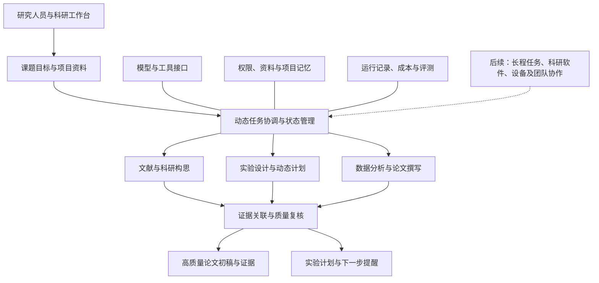

# 研枢科研智能体平台 总体架构图

本图为**跨阶段的逻辑架构**，展示两条并列业务线与支撑能力，并不代表已完成开发。当前首月 Ubuntu 工作站 / Windows 客户端、OpenScience 前端改造、论文双格式与交互甘特图等具体需求请以 [首月 V1 目标与验收决定](../02-实施与评测/首月V1目标与验收决定.md) 和 [工作台验收规范](../04-开发规范/05-工作台与实验甘特图验收规范.md) 为准。图中的连接仅表示职责关系，不是已确定的技术组件或网络拓扑。

论文路线和实验规划路线共享文献、数据、权限与复核底座，二者可在同一项目内衔接。计划提醒由时间或前置任务触发，研究者反馈后可调整后续任务与时间。
