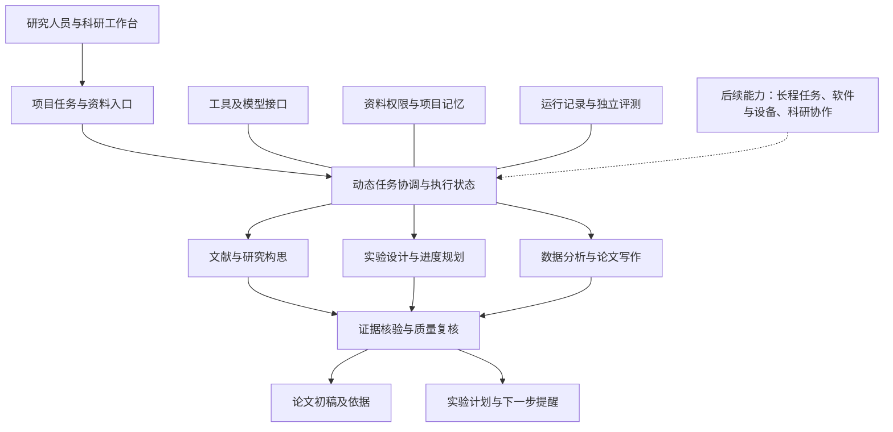
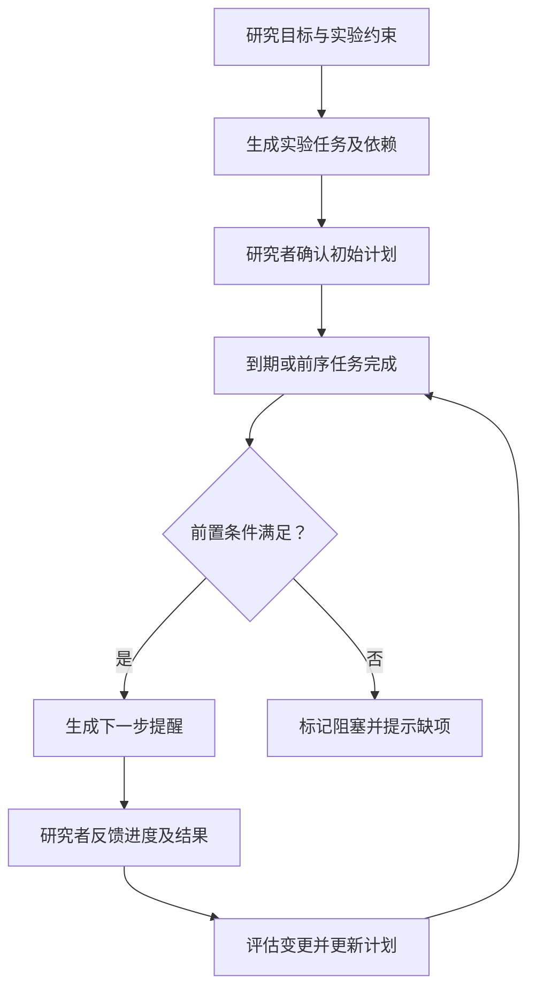
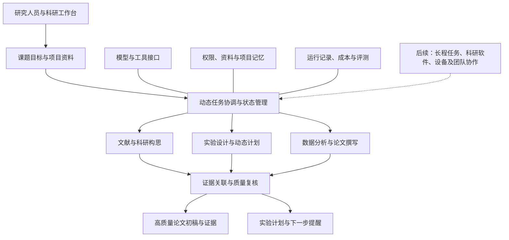

# 项目建设总纲与总体架构

> 由原文件完整合并。保留原条款、时间与预算；旧资料名称只作来源溯源。跨主题内容以链接为准，未经确认的技术选型仍为候选。

<!-- 原文件：docs/01-总纲与架构/01-建设总纲.md；完整保留章节内容 -->

## 研枢科研智能体平台建设总纲

版本：V1｜更新至 2026-11-10｜长期建设基线；首月产品决议已确定，软件与具体技术待验证

### 1. 定位与目标

建设面向科研人员的动态科研工作流平台。研究者提出课题并提供资料、约束与反馈，平台组织科研任务、依据和专业能力，形成可检查的论文初稿与可更新的实验计划。平台围绕项目积累资料、执行状态与经确认的方法，允许研究者随时检查和调整。自动化程度以实际证据与试用效果确定。

第一阶段以材料实验类研究为试点，结合导师异质材料粘接、复合材料制备与性能测试方向；长期架构不锁定学科。**两项并列重点成果**：

- **论文初稿**：基于真实研究资料、实验数据和文献生成逻辑完整、证据可核查、可编辑的论文初稿，尽可能减少专家修改量。
- **动态实验规划**：依据课题目标、实验条件与时间约束生成包含实验顺序和建议时间的计划，持续接收实际进度及新结果，调整后续安排，并在适当时间通知研究者下一步做什么。

两条路线共享研究背景、文献和数据管理，但输入条件、产出和效果评测分别设计；也可在同一个项目内前后衔接。不能用论文写作表现代替实验规划验收。

### 2. 建设原则

1. 以科研结果为导向。导师提出的 12 步是可参考的方法库，按任务需要选择与迭代，不为凑步骤而执行。
2. 从真实材料出发；区分实验事实、文献结论、推测及缺项，不虚构数据、文献、实验执行结果或时间。
3. 平台自主完成可自动处理的任务，科学关键决策、重要实验变更及有争议的结论由研究人员确认。审查以证据为依据，避免无依据削弱合理创新性。
4. 采用公开资料与获得授权的实验室资料，个人、项目、权限分区；未发表资料默认不外传，云端处理须获得明确授权。遵循目标期刊实际 AI 使用和披露规则。
5. 用独立的任务评测和专家试用推动改进；先优化流程、工具与知识组织，是否微调模型以授权、数据质量及实际效果决定。

### 3. 六阶段路线

| 阶段 | 目标与边界 |
|---|---|
| 一 基础科研辅助 | 建设工作台、证据与任务状态；并列跑通论文初稿和动态实验规划，支持实际反馈、计划更新与通知；不自动操作真实仪器或工业仿真。 |
| 二 长程任务与记忆 | 在首期必要的项目保存、进度恢复之上增强跨周跨月任务、多项目协同与记忆治理。 |
| 三 科研软件与计算实验 | 逐步探索仿真软件操作、计算实验及研究课题自身模型训练，前提是许可、资源和实际需求。 |
| 四 实验设备联动 | 在授权、安全联锁和人员监管下探索仪器连接及受控操作。 |
| 五 Skills 与受控改进 | 沉淀经确认的方法，依评测改进策略，授权和条件满足时探索模型微调。 |
| 六 科研 Bot 协作 | 研究者专属助手及明确授权下的团队任务协作。 |

阶段顺序为规划，后续阶段不以本期全部实现为验收前提。第一阶段已要持久化任务和计划；第二阶段是深化，不是首次允许保存进度。

### 4. 第一阶段交付

- 工作台和项目空间：资料上传、项目目标、权限、进度、成果与可追溯记录。
- 论文路线：文献和实验材料处理、数据分析与可视化、可编辑 Word 与 LaTeX 初稿、证据与问题清单。
- 实验路线：实验设计、依赖顺序、预计时间、资源限制、实际状态与结果反馈、调整原因、下一步建议和提醒。
- 共同底座：任务编排、资料索引和证据关联、模型与工具接口、关键质量复核、权限与调用费用记录。
- 验收资料：两条路线各有案例、专家反馈、评测结果、缺陷记录及版本回归记录。质量阈值以试点数据校准，不能用演示通过代替科研质量通过。

### 5. 实施与经费

第一阶段首月按负责人于 2026-11-10 确认的 **C 级较完整 V1 测试版目标**执行：**连续 30 个自然日**，在 Ubuntu 实验室工作站运行科研能力，Windows 客户端可获授权访问；在 OpenScience 现有前端基础上改造工作台，提供真实实验数据到论文主要章节、主动补资料、可编辑 Word/LaTeX、目标期刊选择与证据审查，以及实验设计、依赖、资源、反馈、版本审批、交互式甘特图和运行时提醒。**这些是交付目标，不是已经验证的技术能力。**

时间分为 **Day 1–5 核心底座/数据/权限验证，Day 6–17 双线主要功能开发，Day 18–23 联调与功能冻结，Day 24–30 完整七天试用、科研与安全回归、修复及体验优化**。两名研发人员分工均衡，关键科学判断由研究人员参与。详见 [首月 V1 目标与验收决定](../02-产品与实施/01-首月V1目标与计划.md#src-6)、[首月计划](../02-产品与实施/01-首月V1目标与计划.md#src-7) 与 [导师待审议事项](../02-产品与实施/03-导师方法与待审问题.md#src-10)。

**验收分轨**：软件功能可复现、科研结论真实、科研质量达到导师认可标准是不同判断；导师尚未批准的论文分数和内容深度不得假定达标。首月 V1 完成**不等于整个第一阶段结束**，后续仍需扩充真实样本、独立评测、专家试用和科研质量迭代。

**技术选型边界**：OpenScience 为优先底座但 SDK/Fork/前端源码改动范围、甘特图、期刊导出、Skills、运行观测等均须核对版本与关键实测，先确定《技术选型与集成方案》，再落实《开发实施方案》。见 [技术选型待决与验证清单](../04-技术选型与开发/01-选型与验证.md#src-16)。

第一阶段经费规划暂列 **12,000 元**；首月现金采购上限 **4,000 元**属于其中一部分，并非追加预算或要求花完。采购仍依原有七项额度与实际账单、授权及服务条件执行；工资、硬件与实验耗材是否包含须另行明确，不能把未确认费用视为已覆盖。

---

<!-- 原文件：docs/01-总纲与架构/03-总体技术架构.md；完整保留章节内容 -->

## 研枢平台总体技术架构

版本 V1｜面向建设与汇报；图中为目标能力，未表示已经实现。

### 1. 总体架构图

科研人员在工作台查看任务、资料、论文、实验计划和提醒。任务协调根据目标、状态与条件选择专业能力；复核决定交付、补资料、定点修复或提请人工判断。来源、权限、状态和评测贯穿两条路线。

### 2. 按职责组织

| 组成 | 职责与关键对象 |
|---|---|
| 工作台 | 用户、项目、任务、文件、计划视图、待办提醒及可编辑成果 |
| 协调与状态 | 目标解析、动态步骤选择、任务状态、检查点、失败恢复、预算与审批 |
| 科研能力 | 文献与证据、创新构思、研究方法、实验规划、数据分析、论文与期刊、分离复核；A0—A7 为职责而非固定流水线 |
| 能力接口 | 搜索、学术元数据、文档解析、模型、科学计算、绘图、Word/LaTeX、通知 |
| 数据与知识 | 原文件版本、结构化数据、参考文献、证据链、项目记忆、经确认的方法 |
| 质量与治理 | 访问控制、授权、日志、版本、调用费用、评测和错误恢复 |

建议起步采用模块化服务、关系型数据库保存任务及计划、文件存储保存原始资料和产物；研究性选型先做样例验证。动态协调需要持久状态、条件分支与暂停恢复；定时服务负责到期触发。工具失败不可改写科研事实。

### 3. 两条路线的数据交接

论文输入：课题卡、已授权资料、实验事实、图表/数据、文献记录、期刊规范；输出：论文版本、论断—依据关联、计算结果和待核清单。

实验输入：课题卡、资料依据、样品/变量/对照、设备人员约束、进度、实验观察与日期；输出：实验任务、依赖、预估时长、日程、触发条件、结果、变更版本和提醒记录。论文可引用已完成且可核验的数据，不直接把建议任务当实际结果。

### 4. 实验计划及通知事件

任务字段：project_id、task_id、版本、任务名称、目标、前置依赖、计划开始/结束或窗口、时长估计及依据、状态、材料设备、责任人、完成证据、风险、下次触发。时间应保存时区；资源不可用、延迟、失败、结果不符合预期时重算受影响任务并记录原因。研究者修改须保留版本；不明确时先提示待确认。

通知用稳定事件 ID 去重，记录计划版本、发送状态、重试次数及时间；实验被取消或改期时撤销或替换待发送提醒，服务重启后恢复待发任务。对外通知须用户配置和授权；消息传达不表示收到、接受或完成。

### 5. 证据、权限及恢复

每条关键论断关联来源、文件位置、数据版本、计算脚本或实验记录，并区分可核验、待核实、冲突。系统保存原文和处理结果，不覆盖原数据。权限按用户/项目/文件授权；默认未发表资料不外传，授权后仅发送必要数据，日志避免记录敏感全文。任务暂停、系统重启、限次重试与调用失败应可恢复；科学决定与安全问题由研究者处理。

### 6. 实施边界

第一阶段支持计划与通知，保留基本项目状态；更复杂的长期记忆、仿真软件操作、真实设备控制及跨 Bot 协作依后续阶段推进。最终技术选型按兼容性、许可、可维护性及样例效果验证，不能把图中模块视为已经完成。

### 7. V1 开发职责边界

OpenScience 负责 Research Agent、模型和工具执行、会话及运行回执；研枢负责科研项目、业务任务状态、检查点、证据表、材料规则、实验依赖和独立复审。A0–A7 为按需使用的职责，不强制建立八个相互对话的 Agent。

- [数据库设计](../04-技术选型与开发/03-数据运行与接口.md#src-20) 区分原始来源、计算输入、计算产物、科研论断与证据关联。
- [状态恢复规范](../04-技术选型与开发/03-数据运行与接口.md#src-21) 规定 WAITING_FOR_DATA、WAITING_FOR_CONFIRM 与 RECONCILING，不对 OpenScience interrupted 盲目重放。
- [OpenScience 接口契约](../04-技术选型与开发/03-数据运行与接口.md#src-22) 区分 sessionID、requestID、runID，使用 SDK HTTP/SSE 和 Snapshot 观察执行。
- [材料规则与质量复核](../04-技术选型与开发/04-材料规则与外部接入.md#src-23) 根据已批准的标准、单位、材料和环境约束执行检查。模型不得私自填补数据或修改工艺硬约束。

首月 V1 以 **Ubuntu 实验室工作站**承担 OpenScience 运行和受控科研计算，**Windows 端通过有授权的浏览器工作台访问**；不预设 Windows 独立运行后端。优先复用 OpenScience 原生执行与工具能力，在其已有前端进行必要改造，但 Fork/SDK/前端扩展方式尚须实测。只读原始数据必须有操作系统层面的有效权限；项目目录选择不代表多租户隔离。不得将未经保护的 Runtime API 暴露到外部网络；远程认证、传输与日志外发必须核查。

### 8. 首月产品层和技术选型边界

- **工作台**：项目首页、数据与文献、论文任务及缺项追问、科研证据、审批、运行结果、实验甘特图和提醒须形成可操作的界面；动态甘特图必须连接任务/计划版本与规则校验，不能用静态图代替。见 [工作台与甘特图验收规范](../04-技术选型与开发/05-工作台与甘特图.md#src-25)。
- **论文**：真实数据、可复算计算、主要章节、引文支持、独立复核、期刊选择与 Word/LaTeX 导出；内容深度、期刊规则和具体质量阈值须按 [论文评分](../03-科研质量与样本/02-论文评分.md#src-13) 及 [导师待审议事项](../02-产品与实施/03-导师方法与待审问题.md#src-10) 校准。
- **规划**：实验反馈触发有约束的局部重排，候选版本由研究者批准后生效；运行时提醒要去重，服务重启后补处理，不能把计划或模拟事件写成真实实验事实。
- **可观测性**：OpenScience 运行轨迹与费用记录用于工程排障；原始数据、数值计算和文献论断的学术证据由研枢独立保存。Langfuse 只是候选，不因需求文档提及而自动选定。
- **选型顺序**：先按 [技术选型待决与验证清单](../04-技术选型与开发/01-选型与验证.md#src-16) 核实真实接口、成熟组件和实测可行性，再编写《技术选型与集成方案》及具体《开发实施方案》。本图不是固定技术栈或已建成系统的证明。

---

<!-- 原文件：docs/01-总纲与架构/09-独立总架构图.md；完整保留章节内容 -->

## 研枢科研智能体平台 总体架构图

本图为**跨阶段的逻辑架构**，展示两条并列业务线与支撑能力，并不代表已完成开发。当前首月 Ubuntu 工作站 / Windows 客户端、OpenScience 前端改造、论文双格式与交互甘特图等具体需求请以 [首月 V1 目标与验收决定](../02-产品与实施/01-首月V1目标与计划.md#src-6) 和 [工作台验收规范](../04-技术选型与开发/05-工作台与甘特图.md#src-25) 为准。图中的连接仅表示职责关系，不是已确定的技术组件或网络拓扑。

论文路线和实验规划路线共享文献、数据、权限与复核底座，二者可在同一项目内衔接。计划提醒由时间或前置任务触发，研究者反馈后可调整后续任务与时间。
