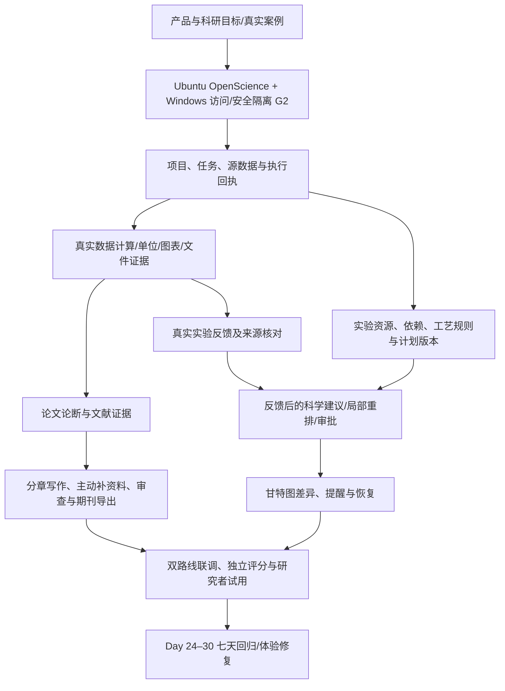

# 研枢 V1 开发实施计划｜先后依赖、外部能力引入与验收

> **记录：2026-11-17｜状态：开发顺序与验收约束已明确，具体技术方案尚待验证。**
> 本文是负责人要求的**开发实施文档（预实施版）**：明确“先做什么、依赖什么、做到什么效果、何时考虑借鉴或接入第三方”。**不是已经批准的最终技术选型或真实开工记录**。Day 1 的实际日期、OpenScience 版本、真实源码路径、第三方版本和工时须经现场验证后填写。
> **优先级**：长期原则与[建设总纲](../01-项目总览/01-建设总纲与架构.md) → 已确认[首月 V1 目标与计划](01-首月V1目标与计划.md)（范围/30 天/预算）→ [第一阶段科研业务规范](02-第一阶段实施规范.md)、[科研深度与两类评分](../03-科研质量与样本/01-科研深度与评测方法.md)（科学约束）→ 本文件（开发先后依赖/阶段验收）→ [F01–F15 功能拆解](00-V1实施总方案.md)（每项实际操作与正反例）→ 经实测批准的[技术选型与验证记录](../04-技术选型与开发/01-选型与验证.md)（组件/接口版本）及[数据运行与接口](../04-技术选型与开发/03-数据运行与接口.md)（实现契约）。低层文档不得修改高层产品决定；不同文档矛盾时暂停争议点并记录裁决。

## 1. 先定执行规则，而不是先安装所有工具

1. **启动前锁定任务范围**：两条完整路径是首月方案 C 的 MUST；每天均属 30 个自然日冲刺，**Day 24–30 完整七天用于真实使用测试、修复及科研/UI 体验改进**，不把主要新功能偷偷挪到测试周。两人全程编码与交叉验收；导师按科学问题参加，不作为全职开发。
2. **只选一套主运行底座**：OpenScience 负责现成 Research Agent、工具、会话、Skills 与通用工作台；研枢自己管理科研项目/任务/证据/实验计划/质量判断。**先实测可复用边界再决定外围接入、前端局部改造、Fork 范围**；禁止为了采用参考项目而再造一套完整 Agent 循环。官方功能也需要版本、许可、权限、成本和实际失败测试。
3. **以证据触发增量接入**：一项功能不存在且成熟组件能解决，做许可/依赖/接口/单例冒烟检查后优先直接接；原生已有但质量不明，做同样本对照；完整科研 Agent 工程一般只借鉴可分离的方法与约束，不直接成为第二主编排。
4. **先保全科研事实**：原始数据真实、获授权、不可写；计算/图表/引文/论文结论可追溯。真实实验反馈与计划建议、真实数据与模拟测试永不混写。科学方向、关键工艺、安全和敏感数据外发保留人工批准。
5. **失败不改目标**：Gate 未通过保留“失败原因、阻塞影响、最小修复或替代选项、负责人批准”，不能悄悄把 MUST 改为 SHOULD、虚称已验收或取消最后七天。30 天是否可完成属于待验证工程风险。

## 2. 文档使用顺序：什么现在需要，什么暂时不用

| 什么时候打开 | 必读文档 | 这时候解决什么 | 暂不做什么 |
|---|---|---|---|
| 决定做什么/验收范围 | [首月 V1 目标与计划](01-首月V1目标与计划.md)、[建设总纲](../01-项目总览/01-建设总纲与架构.md) | 交付双路线、方案 C、预算、权限与 30 天边界 | 不按历史报告重订阶段目标 |
| 制定具体开发顺序 | **本文件**、[F01–F15 功能卡](00-V1实施总方案.md) | 依赖、交接、输入/产物、异常、每日关口 | 不把候选接口当已实测 |
| Day 1–5 验底座与资料 | [选型与验证](../04-技术选型与开发/01-选型与验证.md)、[第三方调研](../04-技术选型与开发/02-第三方组件调研.md)、[数据运行与接口](../04-技术选型与开发/03-数据运行与接口.md)、[测试论文与数据](../03-科研质量与样本/04-测试论文与数据.md) | Ubuntu/Windows、Python、文件只读、运行回执、真实样本与许可 | 不同时接入多套 Harness/大型监控 |
| 做论文 A 路线 | [科研深度与评测](../03-科研质量与样本/01-科研深度与评测方法.md)、[论文评分](../03-科研质量与样本/02-论文评分.md)、[科研业务规范](02-第一阶段实施规范.md) | 输入事实、计算证据、内容深度/缺项追问、格式与质量 | 论文分数未由导师确认前不宣称达标 |
| 做实验 B 路线 | [实验规划评分](../03-科研质量与样本/03-实验规划评分.md)、[材料规则与外部接入](../04-技术选型与开发/04-材料规则与外部接入.md)、[工作台与甘特图](../04-技术选型与开发/05-工作台与甘特图.md) | 工艺、依赖、资源、科学结果反馈、版本/审批、交互视图 | 不因“规划”二字提前做仪器控制/复杂全局优化 |
| Day 18–30 联调/验收 | [F01–F15 功能卡](00-V1实施总方案.md) T01–T15、两类科研评分、[导师待审](03-导师方法与待审问题.md) | 软件、科研事实、科研质量、独立评分器与真实使用 | 未获专家批准的评分权重不视为科学通过 |
| 第二阶段或碰到明确缺口 | [第三方调研](../04-技术选型与开发/02-第三方组件调研.md)、[研究报告归档](../05-研究报告与归档/03-技术复审报告归档.md) | 追溯候选思路、必要时立项复核 | **不因为文档里出现就必须首月集成**：多租户、复杂最优排程、Autoresearch 实验树、RSI、仪器控制、完整长程记忆等 |

## 3. 关键依赖图：先保证下游拿得到可信输入

这是**开发产物依赖**，不是每次科研任务必须经过的固定 Agent 流程。论文可以直接从已有数据开始；实验规划可以先于实际数据进行；公共资源不能等两条路线全部完成后才设计。

## 4. 30 天开发实施时间表（可执行、可检查）

| 日程/关口 | 优先完成的任务及 F 编号 | 能看到的可验收结果（通过后继续） | 两人主要责任与交接 |
|---|---|---|---|
| **Day 1–2：运行与接口摸底** | 固定当前 OpenScience 候选版本、仓库许可证/源码结构；Ubuntu 启动、Windows 授权访问；研究案例授权/源文件哈希；业务 task/run/资料契约草案（F01/F02/F03） | 真实启动日志、Windows 浏览器访问证据、真实材料文件目录和许可；可解释项目/任务/尝试/来源间的关联 | **A** 主运行/安全/状态；**B** 主科研样本/数据契约；互相验证最小操作 |
| **Day 3–5：G1/G2 安全与真实调用** | Agent 真实模型→受控 Python→真实数据→输出；输入只读/输出独立、SSE/重试/崩溃核对；最小项目及任务可保存；技术候选决策登记（F01–F04、F14） | **G2 不可省**：失效账号无法访问、工具无法写入 input、源 SHA256 不变；任务中断不重复写结果；Windows 查看项目状态；资料与调用可复现 | A：Runtime/权限/Task；B：样本/计算/负向测试；共同锁定最小接口 |
| **Day 6–8：双线基础并行** | 论文：真实 Python 指标、图表、来源到计算记录；实验：任务/依赖/资源主数据、工艺规则最小验证；UI：统一导航、状态和甘特图数据模型（F04/F05/F09/F10/F12） | 论文一项结果可沿脚本回原文件；实验 10+ 任务有依赖与资源并能拒绝冲突；两条路线从同一项目/任务接口启动 | B 主论文数据、A 主排程；双方各维护业务 UI，配合项目 API |
| **Day 9–11：G3 早期跨线接口** | 论文引用定位/提纲/期刊格式首样；实验版本草案/甘特交互初版；缺资料问询及审批 UI 先接桩件（F05/F06/F08/F10/F12/F14） | 两条路线都能从真实 UI 创建任务、存结果、刷新重开；引文可跳回原文；至少两种期刊配置可选且一份 DOCX/LaTeX 初样可导出 | B 主证据、章节/导出；A 主版本、甘特/审批；共同联调 |
| **Day 12–14：两路线核心科研效果** | 论文主要章节生成、缺失资料精准追问、数值/引用独立核查；实验延期/失败/新结果→科学解释/备选行动→规则检查（F06/F07/F09/F11） | 一例缺关键数据时不编造；一份有来源的结果与计算核查；一例**可信来源但违背假设的新结果**能提出复测/对照等有理由的候选，而不只移动日期 | B 主论文质量与科学证据；A 主实验科学反馈及变化传播；专家只审关键科学判断 |
| **Day 15–17：闭环与审批提醒** | 论文定点修订、双格式及适用期刊核验；实验候选新计划、受影响任务 diff、批准激活、旧提醒取消/新提醒去重（F07/F08/F11/F12/F13/F14） | 论文修改前后和证据一致；实验未批准版本不激活，真实已做实验不因版本回滚消失；过期/越权审批被拒；通知按有效版本发送 | A 主实验完整闭环与工程恢复，B 主论文交付与独立核查，互测负向案例 |
| **Day 18–20：跨线和体验联调** | 实验真实结果进入论文项目、任务长期重开、崩溃恢复/副作用核对、两种期刊格式回读、UI 视觉系统和复杂甘特情景（F01–F15） | 一个项目中真实反馈能依法用于分析与写作；Windows 完成两条主要路径；界面一致、可交互，不能只交静态图；可定位失败调用/产物 | 两人互相执行对方流程；A 主要修系统与实验，B 主要修论文与评测 |
| **Day 21–23：功能冻结候选** | 补所有 MUST 的实际运行记录、科研证据/专家待核和 T01–T15 正反测试；锁定回归样本、配置及质量报告（F01–F15） | **Day 23 功能冻结判据**：全部 MUST 有可重复路径或明确阻断清单；没有以高自评分/截图替代实际运行；关键科研和文件安全错误处理明确 | A/B 交叉验收，负责人批准是否冻结和缺陷责任 |
| **Day 24–30：完整七天试用与修复** | Windows 研究者真实操作、双路线独立 Eval、科学数据/引用/实验规则负向测试、故意断线重启、复杂甘特/动效/视觉改进、费用与回归（F01–F15） | **G4**：按 T01–T15 保留输入、操作、预期/实际、日志/产物、缺陷/修复；分别报告软件、科学事实、论文/实验质量和待导师项；阻断级安全/真实性缺陷不能带病验收 | 两人每天交叉测试、修复并复跑；导师只评研究方向、机理与科学质量争议 |

**提醒**：上表是目标时间窗，不是已经测出的工时承诺。实际开发可调整某几天先后，只要符合依赖和 Gate，不影响最后七天。严禁从 Day 24–30 挪时间去补本应在 Day 1–23 构建的大型主功能。

## 5. 第三方项目与 Skills：什么时候考虑？什么效果才值得加？

**状态约定：**「现有/待查」= OpenScience 可能已有且须核对；「候选」= 接入接口/依赖尚未验证；「仅借鉴」= 不加入第二套主 Agent。**“到某日考虑”不代表到时必须安装。**优先查 [第三方工具、Skills 与组件研究](../04-技术选型与开发/02-第三方组件调研.md) 的证据、版本、许可证与来源。

| 参考项目/能力 | 最早考虑时间与前置条件 | 目标改进、何时真正需要 | 如何判定采用、暂缓或仅借鉴 |
|---|---|---|---|
| **OpenScience（主底座）** | **Day 1–5，先于核心业务** | 复用会话、Research Agent、工具、Skills、通用 UI，解决 Ubuntu 调用和安全 | 必须实机过 G2；未过先局部排障并升级，不能靠截图假定可用；Fork/SDK 决定另外登记 |
| **原生科研 Skills + K-Dense 单项 Skill** | Day 2–8 盘点；遇到实验/写作/图表明确缺项时 | 补缺失的专业方法，减少自研；不同材料实验按需选 | 先去重、许可/依赖/权限审查、单例运行并记录结果；不全量安装、不把 Skill 视为工具已安装 |
| **Python 科学计算工具** | Day 3–8，样本/单位定义完成 | 复算实验指标、误差和图表 | 输出值与独立计算一致，文件/脚本版本可追踪；先复用标准库，不自建新数值引擎 |
| **data-to-paper（仅借鉴）** | **Day 3–10**，已有真实数据计算/图表 | 解决“正文数值怎样反查数据与代码”，可借鉴数据链和可复核反馈 | 若 OpenScience/研枢已有足够追溯能力，不接完整系统；只提炼独立方法、检查与证据结构 |
| **OpenAlex/Crossref 元数据** | Day 6–11，开始真实文献引用 | 发现/核对 DOI、作者、出版物与版本 | 原生足够则不增加外部服务；元数据存在不等于论断支持，验证调用/限额/授权 |
| **PaperQA2（文献工具候选）** | Day 6–12，**仅在原生文献段落定位、科学论断证据明显缺失或质量不明确时** | 改善 PDF 文献索引、相关段落定位和引用问答 | 缺失先单例冒烟；重叠则同数据 A/B 看引用支持准确率/成本；只取窄范围接口，避免其 Agent 接管全链 |
| **Docling/GROBID/MarkItDown（解析候选）** | Day 3–12，样本含复杂 PDF、表格、公式、补充材料且原生不能可靠读取时 | 避免方法或表格字段漏读 | 同 PDF 做结构与事实还原检查，选一种主要解析方式；无需复杂解析则不接，敏感材料优先本地 |
| **PaperOrchestra（仅借鉴）** | **Day 8–14**，有可信数据、提纲和引用证据后 | 借鉴分章组织、上下文共享、论文审查及局部修订，而非重复运行其整个系统 | 在现有写作环节实现可复用局部模式；若只是多 Agent 讨论却不提高事实/章节质量则暂缓 |
| **Pandoc/Quarto/期刊规则包** | Day 6–11 首样，Day 15–17 完整回归 | MUST：两种期刊配置选择、可编辑 DOCX 和 LaTeX 与图表/公式/引用保真 | 按相同结构化源导出并回读；选实际能保真的成熟工具，不能自称适配所有期刊 |
| **专业甘特图 UI 组件/视觉 Skills/动效工具** | Day 1–5 验前端接入点；Day 6–11 原型；Day 18–30 迭代 | MUST：真实可编辑、多依赖、资源冲突和版本差异；视觉一致、动效合理 | 许可/兼容/事件接口/性能真实检查；Skill 可协助设计与模板，**不能替代真实交互组件** |
| **PaperBench/AstaBench 的评分思想** | Day 1–5 定评测用例；Day 12–30 独立回归 | 借鉴细粒度 Rubric、评测器校准、隐藏集隔离 | **仅借鉴评测方法**；其论文/排行榜分数不能作为材料实验 V1 科研质量阈值 |
| **Langfuse/OTel（运行观测候选）** | Day 18–23，**只有原生日志不足以定位模型/工具故障、耗时/成本时** | 追踪失败所在步骤并关联 Task/Attempt/科研证据索引 | 先本地简易 Trace/费用账，缺口明确才接受控 SDK；日志脱敏、观测故障不影响研究任务，完整自托管后置 |
| **OpenResearch（实验版本候选）** | 完成计算/恢复基线后；首月只有明显必要的版本追踪缺口才评估 | 借鉴实验树、回放、运行记录，而非实验室日程调度 | 对比 OpenScience 原生运行追踪与实际集成成本；首月通常借鉴，不另开第二执行循环 |
| **Google AI co-scientist/Hyra/DeerFlow 等架构思路** | 形成可核验科研发现与工作流瓶颈后，主要为后续 | 借鉴候选假设对抗、层级任务/记忆、长期状态 | 不因此增加固定多 Agent 辩论链；DeerFlow 不是正常情况下的第二主底座，仅阻断后备选研究 |
| **复杂约束求解、RSI/自动优化、仪器联动、多租户** | **首月后置**；除非已确认 MUST 无法用当前方法实现且负责人批准改变路线 | 科学排程规模扩大、长程研究、持续优化、安全设备控制 | 不因“功能先进”首月直接建设；真实科研评测和安全批准是前提 |

### 5.1 复用评审的最小记录模板

新增第三方时，只需在[选型与验证](../04-技术选型与开发/01-选型与验证.md)或研发任务记录写：**触发的具体缺口 → OpenScience 当前表现（有证据）→ 候选接口/版本/许可证/依赖 → 最小冒烟或对照样本 → 改善的科研指标/开发成本 → 对任务状态/权限的影响 → 决议（采用/暂缓/借鉴/拒绝）→ 负责人/日期/回退办法**。明确缺失则不必多轮 A/B；功能重叠但效果不明才做对照；学术质量仍需要专家确认。

### 5.2 不是“想起某个项目了就接进去”

- 必须是在**当前 F 编号功能**遇到缺口才调用对应候选研究，不提前把 20 个项目排成固定部署清单。
- 工具/Skill 引入后仍由 OpenScience 执行编排；业务状态、实验事实、证据与科研审批仍由研枢持有。
- 把上游论文/README 的“可实现功能”写为待验证，不当作研枢已验证或全材料领域适用；Skill 安装成功不等于科学评价通过。
- 未发表材料的外部检索、云模型与遥测调用受原有授权约束，不能为“测试第三方”放开科研数据。

## 6. 可执行任务卡与进度登记（今后按实测更新）

开发时每张 F01–F15 卡都要补一行实际进度；不要把这张进度表复制到十几个文件：

| 字段 | 填写要求 |
|---|---|
| F 编号及 MUST/SHOULD | 直接引用[功能卡](00-V1实施总方案.md)，不重写需求 |
| 上游依赖/交付接口 | 必须注明需要哪项真实输入/字段/视图/源版本，依赖没准备好可以先用明确标记的桩件 |
| 负责人/评审人 | A/B 均为开发者；各条主线互相检查关键改动，不按功能卡数量假定负载相当 |
| 预计工作量与实际消耗 | 首周才锁定人日，随每个 Gate 用实际时间核算；无法完成时升级负责人 |
| 候选技术/决议状态 | 待验证、已实测、采用、暂缓、未通过；记录版本/许可/证据 |
| 状态 | 未开始、进行中、被阻断、待外部资料、待科研审批、完成待验收、通过、未通过；**此处是研发看板状态，不是数据库八状态机** |
| 测试证据 | 关联 T01–T15 正反例、任务 ID、输入/日志/截图/输出版本、实际结果与缺陷编号 |
| 完成条件 | 功能能运行、科研证据可查、负向场景达到预期、代码/文档经他人复核；不能由作者自评 100 分替代 |
| 后续事项 | 尚未通过的科研评审、下一阶段候选和原因；绝不能悄悄降级首月 MUST |

**每个 Gate 的最少交付**：G2 为底座/数据/隔离日志及版本；G3 为两条端到端业务链与科研错误处理；G4 为测试记录、独立科研质量结论、研究者试用与缺陷复测。Day 23 缺任何 MUST 须透明标阻断，Day 30 按实际报告“软件是否交付”和“科学质量是否达标”两种独立状态。

## 7. 启动前及 Day 5 必须锁定、但本轮不能假设已定的项

- Ubuntu 工作站配置、Windows 访问网络与身份/证书策略、可操作用户；没有授权不开放裸 Runtime。
- OpenScience 实际版本、SDK/插件/Fork 方式、原前端改造文件位置、受控工作区和文件权限的真实测试结果。
- 第一个可合法处理的材料数据包与真实方法/单位、目标期刊/稿件类型；科研导师要确认的工艺硬约束及质量阈值保持单独待审。
- 两位研发实际可投入时间，功能分工及耦合、第三方许可/调用费用、关键依赖是否影响最后七天。
- **开发实施文档最终冻结方式**：以本文件为顺序与进度主表，补入通过实测批准的具体技术、代码目录、Task/接口与工作量；必要时形成独立[技术选型与集成方案](../04-技术选型与开发/01-选型与验证.md)和后续修订版。不用历史借鉴项目的未核实能力强行定技术。

**最终验收标准**：这份开发实施计划是否有用，取决于开发者能否按依赖找到“现在该读哪份文档、接下来该交什么、何时该考虑哪个外部能力、没达到怎么办”。它不是对技术已验证、科学评价已通过或 30 天必达的保证。
