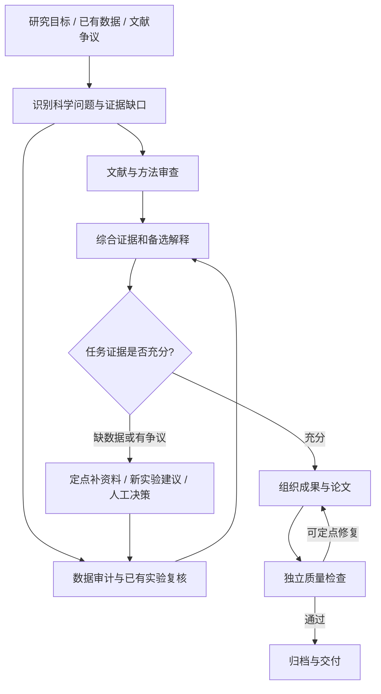

# 研枢科研智能体平台：科研工作流、研究深度与质量评测体系深度调研报告

> **版本**：研究稿 V1.0（2026-11-11）  
> **研究对象**：研枢（Yanshu）第一阶段材料科学实验研究试点  
> **性质**：调研报告、候选评价框架及正式规范增补建议；不代表导师批准，不构成正式技术选型或开发实施方案  
> **编制依据**：本次会话所提供的《科研工作流、研究深度与质量评测体系深度调研任务书》、2026-11-11 已访问的研枢 GitHub `main` 分支相关文档，以及文末标明的公开论文、开源仓库和官方科研规范  
> **资料核查**：2026-11-11；开源仓库及在线标准可能持续更新，正式采用时应保存版本或访问快照  
> **仓库**：[Bluuok/yanshu（私有仓库，需要相应权限）](https://github.com/Bluuok/yanshu)

## 阅读说明与证据标记

- **[官方/论文]**：可从官方仓库、期刊页面、正式规范或原论文直接查证的内容；对应文内编号可在第十五部分查找。
- **[作者评测]**：外部项目在其论文或官方报告中展示的测试结果；不等于在研枢材料研究任务中的独立验证。
- **[仓库现行]**：已读取研枢 `main` 分支相关文件，其内容和状态以访问当日为准。
- **[研枢建议]**：本报告提出的科研深度、执行流程、评分、停止和验收方案；尚未经专家批准或实测校准。
- **[演示]**：为说明规则而构造的数据、分数和情景，绝非实际材料实验或研枢性能测试。

**关键边界**：本文只进行方法论与证据研究，不直接更改 GitHub，不擅自批准论文分数阈值、实验工艺条件或研究方向；首月两条路线、30 自然日和最后完整七天测试等已确认目标不变。

---

# 第一部分：执行摘要

## 1.1 主要结论

研枢必须回答的核心问题并非“Agent 是否写完论文或执行足够多步骤”，而是：它能否基于真实科研资料，在既定研究目标下产生有证据支撑、科学上有意义、可复核、可实际使用的成果。

建议将评价拆成四类，分别报告、分别验收：

| 评价层次 | 必须回答的问题 | 判定方式 |
|---|---|---|
| 科学真实性 | 数据、文献、计算、实验记录与结论是否可信？ | 规则验证、原始证据核对、必要专家裁决 |
| 科研任务与深度 | 是否解决本次科研问题？证据是否足够？ | 按研究类型设定目标深度、证据与验收条目 |
| 科研成果质量 | 论文初稿或实验方案达到哪种质量？ | 原有论文八维评分；实验规划独立评分 |
| Agent 运行质量 | 能否可靠、可恢复、低成本地执行任务？ | 执行测试、错误注入、人工修订量、成本对照 |

软件运行成功、科学事实正确、科学研究深度达标、论文质量达标之间**不能相互代替**。关键科学错误不能被较高的语言或格式分数抵消。

## 1.2 仓库现行基础与差距

已核查下列 `main` 文件：

1. [`docs/01-总纲与架构/01-建设总纲.md`](https://github.com/Bluuok/yanshu/blob/main/docs/01-总纲与架构/01-建设总纲.md)
2. [`docs/02-实施与评测/02-第一阶段实施规范.md`](https://github.com/Bluuok/yanshu/blob/main/docs/02-实施与评测/02-第一阶段实施规范.md)
3. [`docs/02-实施与评测/04-资料收集与评测规范.md`](https://github.com/Bluuok/yanshu/blob/main/docs/02-实施与评测/04-资料收集与评测规范.md)
4. [`docs/02-实施与评测/论文评分.md`](https://github.com/Bluuok/yanshu/blob/main/docs/02-实施与评测/论文评分.md)
5. [`docs/02-实施与评测/导师待审议事项.md`](https://github.com/Bluuok/yanshu/blob/main/docs/02-实施与评测/导师待审议事项.md)
6. [`docs/02-实施与评测/首月V1目标与验收决定.md`](https://github.com/Bluuok/yanshu/blob/main/docs/02-实施与评测/首月V1目标与验收决定.md)
7. [`docs/04-开发规范/04-材料实验规则与质量检查规范.md`](https://github.com/Bluuok/yanshu/blob/main/docs/04-开发规范/04-材料实验规则与质量检查规范.md)

**现有内容应保留**：双路线并列、动态按需编排、实验事实和推断分离、A/B/C 案例分级、开发/回归/独立测试隔离、论文 Q/D/M/R/S/F/L/T 八维评分、科研真实性硬门槛、资料缺失主动追问、重大科学变更人工审批、任务局部修复与版本追踪。[仓库现行]

**需要补充**：

- 科研研究深度与论文论证深度的操作定义；不同任务的深度不能套同一标准；
- 研究问题—必需证据—通过条件的对应关系；
- 实验异常时，如何评价“下一步实验”建议的科学价值；
- 八维细则中的内容深度、交叉映射和重复扣分边界；
- `FAIL`、`N/A`、`UNVERIFIED` 与已确认硬性阻断的统一判定；
- 评分器误报、漏报、定位准确率和专家一致性；
- 检索、继续研究、局部修复、暂停、升级专家的停止条件。

## 1.3 首月执行边界

[仓库现行] 首月已决定 30 个自然日、两位研发、Ubuntu 工作站、Windows 访问、OpenScience 优先底座、最后 Day 24–30 完整七天真实测试；路线 A 为真实数据到论文主要章节与可编辑稿件，路线 B 为动态实验方案、真实反馈、审批和计划更新。

**首月 MUST**：能运行与复现真实数据处理、证据关联、文献定位、内容性论文初稿、资料追问、独立检查、定点修改、Word/LaTeX 导出；能实现实验计划、依赖/资源/工艺约束、实际反馈、科学建议、局部重排、审批与提醒。**首月还必须记录真实科研质量的试评结果**。尚未校准阈值不能宣称科学质量已获正式通过。

**不能仅凭演示宣称**：已具备普遍科学发现能力、已证明特定材料新机理、达到某类高水平期刊投稿质量、自动科学决策已能取代导师。

---

# 第二部分：科研工作的科学方法论

## 2.1 科学研究的目标是什么

真实科学工作至少需要建立五个层次的关系：明确研究问题；识别已知信息和知识空白；提出可检验的解释；通过合适的观测或实验获取证据；明确结果支持什么、尚不能支持什么。

以“某种界面处理能否改善复合材料胶接性能”为例：

| 研究主张 | 主张类型 | 对应必要证据 | 不能跳过的区分 |
|---|---|---|---|
| 处理组平均强度比对照组大 | 观测/描述 | 真实试样、测试条件、数据 | 不能直接等同实际效应稳定存在 |
| 在研究范围内，处理提高了强度 | 有条件的研究结论 | 适当对照、重复或适用推断、偏差检查 | 不得忽略环境和制样差异 |
| 改善与表面形貌变化有关 | 关联解释 | 形貌与强度的对应证据 | 相关性不等于因果性 |
| 化学键合变化导致强度改善 | 因果或机理主张 | 机制相关表征、可区分的对照及反例讨论 | 不能从强度提高直接推断化学机制 |

研究深度取决于问题与证据是否匹配，而不是每篇论文都进行同样复杂的机理分析。方法学、数据型、验证型和机理型研究的高质量标准可能不同。[研枢建议]

## 2.2 研究目标—科学价值—证据—完成标准

| 研究类型 | 核心科学价值 | 必需证据 | 可宣称完成的条件 |
|---|---|---|---|
| 信息调查 | 说明领域已知情况 | 可验证来源、检索范围 | 任务重点已覆盖且重要争议明确 |
| 现象描述 | 建立可靠观察事实 | 测量、条件、单位、误差 | 观察真实、报告不越界 |
| 比较研究 | 识别材料或方法差异 | 可比条件、对照、差异及不确定性 | 对比成立或局限已说明 |
| 关联研究 | 发现变量间关系 | 成对数据、合适统计/模型 | 能区分关联与因果、检验稳健性 |
| 验证研究 | 检验已有假设或结论 | 预先明确的假设、方法、独立验证证据 | 明确支持、不支持或暂无法判断 |
| 方法学研究 | 改进测量或分析 | 基线、误差、偏差、适用范围 | 方法优劣及条件得到证据支持 |
| 机理研究 | 区分竞争解释 | 机制预测、关键表征、有识别力的实验 | 主要解释有实质性支持且反例受审查 |
| 数据研究 | 提供可复用科研资源 | 数据质量、元数据、来源、许可 | 数据能被理解、审计、依法复用 |
| 创新发现 | 提出新的可靠认识 | 直接相关现有工作对照、新结果与复核 | 贡献、边界、新颖性得到可信论证 |

## 2.3 什么叫“好的科研问题”

可从清晰性、可检验性、重要性、新颖性、可行性分别评价，不宜混成一个印象分：

1. **清晰性**：材料、变量、性能和适用边界可明确陈述；
2. **可检验性**：存在可能反驳假设的实际观测结果；
3. **重要性**：理论、方法或实际应用意义有依据；
4. **新颖性**：与最接近研究的差异能逐项说明；
5. **可行性**：现有资源、仪器和测量条件能够回答该问题。

创新状态建议区分：`待检索` → `发现差异证据` → `初步新颖性支持` → `经针对性文献/专家核查` → `由实际研究证据支持`。未查到论文不等于“首次发现”。当研究者已有创新主张时，Agent 应优先验证其合理性，而不是自行替换。[研枢建议]

## 2.4 科研完成度的多轴记录

| 维度 | 建议状态 |
|---|---|
| 研究方案 | 未设计 / 待确认 / 已批准 |
| 实验执行 | 未开始 / 进行中 / 完成 / 失败 / 未知 |
| 数据 | 未提供 / 已上传 / 待核查 / 已验证 |
| 科学结论 | 假设 / 部分支持 / 证据不足 / 经复核 / 被反驳 |
| 论文 | 提纲 / 部分初稿 / 主要章节初稿 / 待修订 / 投稿准备待确认 |
| 科学质量 | 未评价 / 受阻 / 不通过 / 通过 |
| Agent 执行 | 可执行 / 待资料 / 待审批 / 恢复核对 / 停止 |

不能把“论文初稿完成”推断为“实验已做完”，也不能把“真实数据已上传”推断为“科学结论已验证”。

---

# 第三部分：科研任务能力和研究深度体系

## 3.1 十项科研能力矩阵

| 科研能力 | 目的与必要输入 | 主要工作 | 产出 | 进阶深度要素 | 自动/人工验证与失败条件 |
|---|---|---|---|---|---|
| 文献研究 | 问题、关键词、文献 | 检索、去重、比较正反证据 | 证据矩阵、争议清单 | 研究条件差异、覆盖盲区、停止理由 | DOI/原文检查；摘要拼接不能通过深入综述 |
| 问题与假设 | 目标、已知事实、资源 | 定义检验变量、候选解释 | 假设—预测表 | 替代假设与证伪条件 | 专家核对；“所有结果都算成功”为失败 |
| 实验设计 | 问题、材料、标准、约束 | 变量、对照、采样、资源规划 | 可审查实验方案 | 区分替代解释与测量偏差 | 规则＋专家；缺必要对照或违反硬约束不能通过 |
| 实验记录 | 试样、执行记录、仪器/人员反馈 | 区分计划、观察与真实执行 | 事件、试样、数据来源记录 | 真实性和完整性，而非自动化级别 | 记录核查；编造已做实验为严重错误 |
| 数据分析 | 原始文件、单位、分析口径 | 清洗、复算、统计、可视化 | 可重跑脚本、表格、图表 | 不确定性、稳健性、异常处理 | 代码复算；选择性删点与错单位失败 |
| 科学解释 | 结果、文献、方法、误差 | 形成解释、对照反例 | 结论—证据矩阵 | 因果边界、竞争机制 | 专家；无机制证据却称已证明为失败 |
| 动态决策 | 计划、真实反馈、资源 | 复核异常、提出行动方案 | 备选动作、依据、变更草案 | 信息价值、局部调整 | 情境测试；未经审批改动关键条件为失败 |
| 论文内容 | 已确认数据、方法、文献、期刊要求 | 组织并撰写主要章节 | 有科学内容的初稿 | 论证链、对比、局限 | 逐章检查；只有标题无内容不足 |
| 独立复核 | 初稿、规则、原数据与来源 | 错误注入检查、数值与引文核验 | 错误清单、证据位置 | 能识别重大学术越界 | 专家和规则对照；仅主观打分不可接受 |
| 交付与复现 | 文件、脚本、版本、审批 | 导出、归档、可恢复复算 | Word/LaTeX、数据链、待办 | 交付可持续复核性 | 文件重开/编译；来源断链或文件损坏失败 |

## 3.2 文献研究怎样达到“深入”

深度不以引用篇数单独衡量，应先列出任务要回答的关键问题，再检查核心论文、最近相关研究、重要反面证据、适用实验条件、检索盲区、论断支持。适当采用关键词变体、前向/后向引文追踪；新增检索不再实质改变主要判断，且关键问题被足够覆盖时，可以停止。不能用“在已检索范围未发现”替换“全球没有任何先例”。[研枢建议；检索与引用评价思想参考 R05、R09、R10]

## 3.3 实验设计怎样达到“深入”

必须说明：哪一变量回答哪一问题、哪些条件应控制、对照为何有识别力、样本与测量精度依据是什么、什么观测支持或反驳假设、哪些新实验可以区分竞争解释。不得自行规定适用于所有材料的统一试样数量、固化时间、试验速度。[参考 R14、R15]

## 3.4 数据分析怎样达到“深入”

核对原始文件、数值类型、单位换算、试样身份、有效区间、异常值与缺失值、统计适用前提、误差与不确定度、绘图源数据、脚本版本。核心标准是**计算可复算，并且结论强度与数据质量相称**；复杂统计模型并非每个材料试验的必要条件。[参考 R16]

## 3.5 哪些内容可自动验证

- 程序/规则适用：文献元数据存在性、数值计算、单位维度、文件哈希、图表数据一致性、明确批准的硬约束、依赖环、导出可打开性。
- 独立模型可辅助：文献语义支持、逻辑断裂、疑似错误和缺失资料定位。
- 研究者/导师裁决：科研重要性、复杂机理、替代解释是否充分排除、实验设计科学适用性、创新贡献、重要变更与危险操作。

模型复核不是独立科学真值；源数据正确与否不能由代码运行成功推断。

---

# 第四部分：真实科研与论文写作流程

## 4.1 实际科研过程的必要依赖

可能入口包括：提出研究目标、已有真实数据、文献争议、偶然结果或待修改论文。文献研究、部分数据核查和论文提纲可并行；结果解释可能要求补实验，补实验也可能要求重写 Discussion。**不要求所有任务都经过固定十步或十二步。**



必要依赖举例：没有可靠测量不能宣称获得真实 Results；没有相应表征不能断言机理已证实；未经批准不能激活重大实验变更。

## 4.2 论文逐章科学深度表

| 章节 | 内容深度要求 | 必需证据 | 典型浅层错误 | 主要原评分映射 |
|---|---|---|---|---|
| Abstract | 目标、方法、实测关键结果与结论一致 | 与正文一致的真实结果 | 空泛“显著提升”无量化支持 | S4、D、R |
| Introduction | 背景→最接近研究→未决问题→本文目标 | 可定位的相关与相反文献 | 文献罗列，不识别研究空白 | Q、R4、S2/S3 |
| Methods | 材料、试样、对照、条件、仪器、分析可复核 | 原始记录、方法与标准版本 | 只有“按某标准测试”没有必要条件 | M1–M5 |
| Results | 每个重要结果有数据、统计口径和图表 | 原始文件、脚本、图表源数据 | 只展示好看的图，不解释样本差异 | D、S4 |
| Discussion | 与文献比较，解释现象、替代解释及局限 | 可比数据、表征、竞争解释 | 把相关性写成机制已证实 | Q3、R、S3 |
| Conclusion | 回答目标、控制主张范围 | 主要结论对应实际结果 | 推广到未测试条件 | R、S |
| 引文/图表/补充 | 引文真实且支持对应论断，资产可追溯 | 原文位置、数据与文件版本 | DOI 存在但内容不支持主张 | Q、D、F、T |

ICMJE 的 IMRaD 内容原则可跨学科参考，但其医学研究特定规则不应直接作为材料科学硬条件；Nature Communications 的 Methods 作者指南强调解释与复制结果所需的要素。[R11、R12]

## 4.3 内容完成层次

- **P0 结构存在**：有适用章节框架；
- **P1 内容覆盖**：必要实验事实与结果基本具备；
- **P2 科学论证充分**：证据、比较、解释、替代原因与局限符合任务目标；
- **P3 投稿准备候选**：P2 基础上满足目标期刊、稿件类型、阶段及专家审查。

P3 不等于保证录用，也不能由总字数或期刊影响因子代替。[研枢建议]

## 4.4 真实案例一：木质素—纤维素复合材料

**论文**：Zuo, S., Schick, L. W., Muangmeesri, S. *et al.* *Composites of covalently linked lignin and cellulose from one feedstock*. **Nature Communications 17**, 9145 (2026)，2026-08-27，DOI [10.1038/s41467-026-77206-8](https://doi.org/10.1038/s41467-026-77206-8)。[R18]

**原论文可查事实**：作者使用经处理的木质素与纤维素构造复合材料，利用滤纸模型筛选固化温度，并进行力学性能与化学相关分析。论文正文报告：在 180°C 固化时模型复合物拉伸强度为 **60.8 MPa**；无 DMAP 催化剂对照为 **18.6 MPa**；滤纸对照为 **11.3 MPa**。这些数字是**论文报道值**，本次未对 Source Data 文件执行复算。论文页面列有补充材料与 Source Data ZIP 入口。[R18]

| 科研主张 | 证据类别 | 对研枢测试的意义 |
|---|---|---|
| 制备或固化条件影响性能 | 不同处理条件下的测量 | 检查实验条件与数据对齐 |
| 性能改善 | 实际力学数据与对照 | 检查图表/数值复算 |
| 催化剂的作用 | 含/不含催化剂对照 | 验证对照实验识别力 |
| 存在相关化学连接机制 | 化学表征与反应机理推断 | 区分实测性能与机制证据 |
| 湿态表现 | 实际湿态测试 | 限定环境适用范围 |

**Agent 应追问**：试样尺寸、有效截面、各试样原始曲线、固化时间与温度、加载速度、环境、重复定义、不同测量对应的试样身份。**本报告建议**将“有源数据下载入口”列为候选，不得在逐文件验证之前标为全部原始数据完备的 A 类案例。

## 4.5 真实案例二：复合材料粘接强度评价

**论文**：Takamura *et al.* *Evaluation of True Bonding Strength for Adhesive Bonded Carbon Fiber-Reinforced Plastics*. **Materials 17**(2), 394 (2024)，DOI [10.3390/ma17020394](https://doi.org/10.3390/ma17020394)，开放全文 [PMC10817254](https://pmc.ncbi.nlm.nih.gov/articles/PMC10817254/)。[R19]

**原论文可查事实**：论文比较单搭接剪切、平面法向拉伸和压缩式剪切等构型，讨论表观测量强度、数值模型所得界面应力与胶层厚度的关系。单搭接剪切的弯矩可导致复杂应力状态，因此测量结果不能不加说明地当作真实界面本征强度。[R19]

| 检查点 | 合格的 Agent 行为 | 典型失败 |
|---|---|---|
| 强度指标解释 | 区分表观强度与界面强度 | 直接等同两个量 |
| 比较厚度/测试构型 | 核对几何、应力状态、模型限制 | 只排序数值 |
| 解读仿真 | 标记模型假设、参数和实验验证 | 仿真结果冒充实测事实 |
| 下一实验设计 | 说明新增测试能够区分的原因 | 无目的无限增加实验 |
| Discussion | 比较方法适用性与解释边界 | 复述结果而无分析 |

论文显示的是研究方法逻辑，并非证明其所有原始仪器记录和仿真源文件已经公开。是否可作完整复现型 A 类样本仍需实际下载核验。

## 4.6 两个案例的对照结论

案例一更偏向“制备—性能—对照—化学证据—机制”；案例二更偏向“测量—识别方法偏差—模型—不同试验构型比较—适用范围”。二者分别说明：**科研深度是问题特定的证据深度，不是统一的高级仪器或多步骤流程清单。**

## 4.7 正式材料标准的适用范围

- ASTM [D3039/D3039M-17(2025)](https://store.astm.org/standards/d3039_d3039m) 涉及聚合物基复合材料拉伸特性；材料、制备、铺层、环境、夹持、速度等条件对结果有影响。[R14]
- ASTM [D1002-10(2019)](https://store.astm.org/d1002-10r19.html) 是金属单搭接粘接试样表观剪切强度的特定比较性方法；不应泛化成所有胶接材料或接头的固有设计强度规则。[R15]

平台规则应包含标准编号、版本、适用材料、试样、环境与批准状态。标准页面公开摘要并不代表已经取得付费全文或获得全部使用许可。

---
# 第五部分：现有科研 Agent、开源项目及论文方法比较

## 5.1 八个重点项目比较矩阵

以下“能力”以官方材料可确认的实现目标或公开机制为主；凡涉及科学效果的表述，不能超出作者实际测试任务的适用域。

| 项目 | 科研任务 | 研究深度与主要证据机制 | 独立评价 | 科学决策能力 | 实证局限 | 借鉴/复用类型 |
|---|---|---|---|---|---|---|
| **OpenScience** | 研究工作台、文件/代码/科研任务执行 | 任务计划、运行工具、保存可检查产物 | 需要研枢自行验证材料流程 | 可编排研究工作，但具体科学决策不应默认可靠 | 底座本地兼容、安全及业务状态待实测 | 优先复用执行与工作台 [R01] |
| **data-to-paper** | 从科研数据到论文 | 数据、脚本、数值、论文的可反向追踪关系 | 作者展示测试与可审计链 | 能提出研究分析假设；非普适实验设计验证 | 主要为相对简单数据和统计问题设计 | 借鉴可追溯计算，可测局部复用 [R02、R03] |
| **PaperOrchestra** | 非结构化研究材料到 AI 论文 | 提纲、文献综合、分章写作、图表、修改 | PaperWriting-Eval200 等作者评测 | 主要处理论文内容组织 | AI 研究论文任务不代表材料实验全流程 | 借鉴写作和交叉审查 [R04] |
| **PaperQA2** | 科学文献问答与综述 | 文档搜索、证据汇集、上下文重排、带引文回答 | 研究论文对文献任务评测 | 不能替代实验因果判定 | 文献检索能力≠独立科研发现 | 证据检索服务候选 [R05、R06] |
| **Google AI co-scientist** | 科学假设与研究建议 | 候选生成、反思、排名、进化、专家反馈 | 自动 Elo 与小规模专家/实验评测 | 可提出假设和备选验证 | 自动评价不是科学真值，样本领域有限 | 借鉴假设比较，不照抄 Agent 数 [R07] |
| **PaperBench** | AI 论文复现 | 分层 Rubric、真实执行结果、Judge 校准 | 论文作者共同编写任务，另外测评评分器 | 主要考察复现任务 | 不能直接迁移材料论文评分阈值 | 借鉴任务 Rubric 和独立 Judge [R08] |
| **AstaBench** | 多类型科研 Agent 基准 | 文献理解、科研代码、数据与端到端任务 | 分任务排行榜与框架 | 依据任务不同 | 不覆盖所有真实材料实验条件 | 借鉴跨任务评测设计 [R09] |
| **K-Dense Scientific Agent Skills** | 专业科研工具和方法 | 不同领域独立 Skill、数据库与计算工具 | 具体 Skill 依自身测试和专家验证 | 部分辅助方案生成与工具执行 | 安装可用不代表科学输出已核准 | 仅按实际能力缺口选用具体 Skill [R10] |

## 5.2 OpenScience

- 官方仓库：[synthetic-sciences/openscience](https://github.com/synthetic-sciences/openscience)。
- **[官方/源码]** README 将其定位为本机科学研究 AI 工作台，可围绕自然语言目标读文献、处理文件、运行代码、形成可检查结果；源码包含前后端和评测相关模块。[R01]
- **研枢适用方向**：利用其工作台和已有工具运行能力，结合研枢业务状态、证据和审核规范进行测试。
- **必须真实验证**：Ubuntu/Windows 可用性、原始文件隔离、代码执行返回、状态恢复、取消或重试后的副作用核对、模型费用与权限。当前不应把 README 所列能力认作材料实验质量实测通过。

## 5.3 data-to-paper：数值追踪优先

- 官方仓库：[Technion-Kishony-lab/data-to-paper](https://github.com/Technion-Kishony-lab/data-to-paper)。
- 论文：Ifargan, T., Hafner, L., Kern, M., Alcalay, O., & Kishony, R. *Autonomous LLM-Driven Research — from Data to Human-Verifiable Research Papers*，DOI：[10.1056/AIoa2400555](https://doi.org/10.1056/AIoa2400555)。[R02、R03]
- **[官方/源码]** 框架将科研分析代码、结果和论文数字关联，可把论文中数值追溯到产生它的代码。包含 AI 与规则性组件、代码保护措施、回退与人工引导。README 也指出系统目前面向较简单研究目标和数据集。
- **[研枢建议]** 应在每个重要数字上维持 `论断 → 结果/图表 → 计算脚本+参数 → 原始文件+条件` 关联。代码执行正确只能说明计算链可追踪，不能单独证明测量可靠或研究结论科学正确。
- **复用与借鉴区分**：先借鉴“data-chaining”可审计机制；具体源代码能否融入 OpenScience 底座，仍须技术和许可证测试，不作正式集成决定。

## 5.4 PaperOrchestra：研究资料到论文

- 官方仓库：[google-research/paper-orchestra](https://github.com/google-research/paper-orchestra)。
- 论文：Song, Y., Song, Y., Pfister, T., & Yoon, J. *PaperOrchestra: A Multi-Agent Framework for Automated AI Research Paper Writing*，arXiv:2604.05018；Google Research 官方条目将其列为 **Third Conference on Language Modeling (2026)**。[R04]
- **[官方/论文]** 处理非结构化研究构思、实验日志与预写作材料；通过提纲、文献综述、章节生成、修改和可视化形成 LaTeX 稿件。官方介绍的 PaperWriting-Eval200 基于 200 篇 AI 会议论文反向构造预写作材料，实验强调文献综合、覆盖及稿件质量。
- **边界**：作者报告的评测结果不能推断其已经可靠处理复合材料原始力学曲线、试样身份及材料机理。
- **[研枢建议]** 借鉴“先证据组织，后分章写作；再审查章节一致性”的思想，但不强制固定多 Agent 链。需要通过对照实验证明增加角色相较简单工作流带来可测收益。

## 5.5 PaperQA2：真实引文与有效支持分离

- 官方仓库：[Future-House/paper-qa](https://github.com/Future-House/paper-qa)。
- 论文：[Language agents achieve superhuman synthesis of scientific knowledge](https://arxiv.org/abs/2409.13740)。[R05、R06]
- **[官方/源码]** 包含科学文献元数据、全文检索、证据切分与检索、上下文排名、带引用答案等机制。
- **重要区分**：`真实文献`、`准确定位`、`与问题相关`、`能支持论断`、`证据已充分` 是独立检查对象，不能仅以 DOI 存在证明科学断言得到支持。
- **研枢适用性**：选定材料主题构建受控问答集合，记录证据召回、位置、支持判断、错误与时延。服务是否直接复用待比较许可、数据与成本。

## 5.6 Google AI co-scientist：科学假设的竞争和反证

- 官方介绍：[Accelerating scientific breakthroughs with an AI co-scientist](https://research.google/blog/accelerating-scientific-breakthroughs-with-an-ai-co-scientist/)，2025-02-19。[R07]
- **[官方/论文]** 包含 Generation、Reflection、Ranking、Evolution、Proximity、Meta-review 等角色。官方说明 7 位专家提供 15 项开放研究目标，部分专家偏好评价针对其中 11 项；Elo 属于系统内部评价指标，非独立科学真值。
- **[研枢建议]** 借鉴对多个解释的预测和证据比较：例如异常强度可能来自工艺、环境、试样或测量，而应优先选能区分这些解释的检查/实验。不要因为 co-scientist 使用多角色，就认定研枢必须复制六个 Agent。

## 5.7 PaperBench 和 AstaBench：评分规则必须可验

- [PaperBench 官方介绍](https://openai.com/index/paperbench/)（2025-04-02）：20 篇 ICML 2024 论文复现任务、8,316 个单独可评分的子任务、作者参与的分层 Rubric，另有对评分器本身的评价。其当时所测最佳 Agent 平均复现得分为 **21.0%**，仅适用于该测试配置。[R08]
- [AstaBench 官方介绍](https://allenai.org/asta/bench)：区分科学文献理解、科研代码与执行、数据分析及端到端任务等，并提供分任务基准和评测框架。[R09]

**对研枢的含义**：必须建立“任务—可验证产物—具体 Rubric—独立检查—专家校准—回归”关系。不能引用外部排行榜分数作为材料论文或实验规划达标线。

## 5.8 K-Dense：具体 Skill 值得评估，整库集成没有必要

- 官方仓库：[K-Dense-AI/scientific-agent-skills](https://github.com/K-Dense-AI/scientific-agent-skills)。项目持续更新，包含多种科研软件、数据库和领域工作流 Skill；仓库自身也提示社区贡献的验证程度不同，推荐按需安装并检查权限和依赖。[R10]
- **[研枢建议]** 分清能直接使用的数据库/解析器/计算器、值得借鉴的策略、可能风险较高的科学建议生成。每个候选记录版本、输入输出、许可、科学验证方式、错误情况与维护成本。首月不因规模大而整体接入。

## 5.9 比较结果与复用优先次序

| 需求 | 研究来源 | 推荐下一步 | 是否正式选型 |
|---|---|---|---|
| 科研任务运行与工作台 | OpenScience | 本地关键功能实测 | 否；现行优先底座不变 |
| 论文数值可追踪 | data-to-paper | 测最小 `数值—脚本—文件` 链 | 否 |
| 引文真实性和证据支持 | PaperQA2 / OpenScholar | 相同材料论文证据集对照 | 否 |
| 复杂原始材料到论文 | PaperOrchestra | 测内容覆盖和人工修改时间 | 否 |
| 竞争假设与新实验信息价值 | AI co-scientist | 基于材料异常场景检验 | 否 |
| 独立质量评分 | PaperBench / AstaBench | 设计和校准细粒度 Rubric | 否 |
| 专业工具和数据库 | K-Dense | 按单个缺口评估 Skill | 否 |

---

# 第六部分：研枢动态科研工作流建议

## 6.1 工作流的决策原则

任务执行的基本单位应是当前科研问题和其证据状态。应保存 `research_goal`、`research_type`、`available_evidence`、`required_outputs`、`unresolved_questions`、`approved_constraints`、`evaluation_requirements`、`execution_state` 等概念字段；这些仅是业务契约示意，不是本次数据库决议。[研枢建议]

## 6.2 多入口与最小必要步骤

| 任务入口 | 最小必要工作 | 可跳过项 | 触发额外工作 |
|---|---|---|---|
| 真实数据与方法较完整 | 数据审计→计算→证据组织→初稿→复核 | 重复设计已完成实验 | 方法缺漏、结论不受支持 |
| 只有部分实验数据 | 清点缺项→可独立分析部分先做 | 等齐全部数据才开始一切 | 核心推断依赖缺失资料 |
| 只有课题目标 | 问题→文献→假设→实验建议 | 不生成虚假的 Results | 缺对照、资源不足或风险 |
| 有批准的实验计划 | 审查科学性、依赖和约束 | 无必要的重新建计划 | 实际延期、失败、异常数据 |
| 有结果但假设不符 | 原始核查→备选解释→下一步建议 | 一上来重置整个课题 | 必要复测、对照或重大变更 |
| 已有论文草稿 | 独立检查→定位缺陷→局部修订 | 固定重跑选题、实验和写作全部步骤 | 核心事实或方法不可靠 |
| 单个引用不支持论断 | 精确补查来源和改写 | 重跑所有数据分析 | 该引用影响研究核心结论 |

## 6.3 实验异常后的决策流程

1. **事实层**：确认反馈来自谁、哪个试样/设备、什么时间、哪些真实测量与条件；
2. **质量层**：检查量纲、样品映射、测试条件、异常与变异；
3. **科学层**：判断结果是否实质反驳原假设，列出有证据支持的替代解释；
4. **行动层**：比较维持计划、复测、新增对照、改变方案或暂停的科学信息价值与代价；
5. **约束层**：检查已确认的材料、工艺、安全、设备与预算边界；
6. **人工层**：涉及研究方向/重要参数/危险操作变动时等待批准；
7. **执行层**：只更新受影响任务，留存变更前后、理由、审批与旧提醒撤销信息。

模拟情境仅用于测试，必须标为模拟；不能把专家设定的进度或数据解释为论文作者真实执行记录。

## 6.4 工作流合理性检查

| 检查项 | 合理表现 | 不合理表现 |
|---|---|---|
| 必要性 | 每一步能提供证据、解决缺陷或完成交付 | 无效重复搜索和自评 |
| 科学充分性 | 关键结论有必要证据 | 工作流跑通即宣布科研完成 |
| 确定性工具 | 算术、格式与硬约束优先规则 | 只依赖模型猜测 |
| 失败隔离 | 失败任务局部修复并核对副作用 | 单引用错误导致全链重做 |
| 资料缺失 | 精确追问并允许其他部分继续 | 编造输入或无差别暂停 |
| 授权安全 | 重要决策批准后生效 | 自动变更研究方法或操作权限 |
| 效果评估 | 比较实际质量、工时和成本 | 角色数量越多越“先进” |

## 6.5 停止、继续、追问及人工升级状态

| 证据/状态条件 | 建议动作 | 结果标记（候选） |
|---|---|---|
| 必需目标与证据已满足，评审通过 | 交付并归档 | `COMPLETED` |
| 缺可补充的重要实验条件 | 具体追问，仅阻塞依赖步骤 | 现有 `WAITING_FOR_DATA` |
| 科学争议或重要方法变更 | 给出选项并请求确认 | 现有 `WAITING_FOR_CONFIRM` |
| 已确认真实性硬错误 | 阻断受影响成果交付 | `BLOCKED` |
| 能通过修订解决 | 定点修改→同条件复测 | `REVISING` |
| 新搜索不再显著增加有效证据 | 保存覆盖范围并停止检索 | `STOPPED_NO_GAIN` |
| 达预算/时长上限 | 保留中间产物和未完成状态 | `PAUSED_BUDGET` |
| 当前资料不可能达到目标深度 | 报告科学缺口、建议研究者处理 | `NOT_ACCEPTED` |

新增状态名称只是候选，正式实现时应与既有 `RECONCILING` 等状态契约对齐，不重复设计。

---

# 第七部分：研究深度判定体系

## 7.1 三个不可混同的维度

- **A：科学研究深度**：问题、假设、实验设计、证据、分析和解释；
- **B：论文内容及论证深度**：内容覆盖、证据链、可比研究、讨论、限制；
- **C：Agent 自主处理深度**：任务串联、追问、修复、恢复、预算和审批。

某个系统可以记录成 `A3/B2/C3`，这并不是一个简单平均分。高度自动化可以做出浅层结论；研究者参与较多的流程也可能产生很高质量研究。[研枢建议]

## 7.2 A：科学研究深度

| 等级 | 主要能力 | 必需证据与产物 | 典型浅层错误 | 达标但仍不能通过的情况 |
|---|---|---|---|---|
| A0 | 信息整理、复述 | 标注来源的摘要/清单 | 拼接二手摘要 | 来源不真实 |
| A1 | 事实核查、基础分析 | 可核查事实、基础复算、数据表 | 未核单位和样本 | 原始数据关键错误 |
| A2 | 比较证据、解释结果与边界 | 可比性分析、冲突/局限清单 | 条件不可比仍排名 | 缺主要反证或误读数据 |
| A3 | 可检验假设、验证设计与替代解释 | 假设—预测—对照—结果判据 | 无论什么结果都支持假设 | 方案违反安全/资源硬约束 |
| A4 | 综合独立证据及实际反馈并经科学审查 | 验证结果、独立核查、适用范围 | 仅多个模型同意就宣称证明 | 重大事实或方法问题未解决 |

A4 不等于每项科研任务都必须有新机理。资料整理任务可在 A1 合格，科学综述可能以 A2 为主要目标，方案设计以 A3 为适宜目标；实际验证型研究才需要与其目标对应的 A4 证据。

## 7.3 B：论文论证深度

| 等级 | 标准 | 常见不足 |
|---|---|---|
| B0 | 有提纲/语言，但未形成可靠科研内容 | 章节标题齐全却无数据 |
| B1 | 核心事实和方法基本覆盖，主要为描述 | 无比较和解释 |
| B2 | 数据与文献有合理综合，结论有条件 | 重要替代解释尚未处理 |
| B3 | 形成问题—方法—证据—解释—限制的完整论证 | 有局部不足但不破坏核心推断 |
| B4 | 已经过独立科学审查，关键事实、论证及目标稿件阶段要求可满足 | 仍不代表期刊已录用 |

B 级按研究和稿件类型定义检查项。数据论文不能因缺乏机理假设而自动判低分；方法学论文侧重误差、与基线比较、适用域。[研枢建议]

## 7.4 C：Agent 自主深度

| 等级 | 主要能力 | 必须验证的行为 |
|---|---|---|
| C0 | 文本性科研辅助 | 不编造来源、明确人工责任 |
| C1 | 独立执行单项检索/计算/写作 | 任务输出可检查 |
| C2 | 关联任务并识别资料缺项 | 能精准追问、保存状态 |
| C3 | 根据结果触发局部调整、错误修复与恢复 | 中断/异常/新数据测试通过 |
| C4 | 受控长程任务动态编排 | 持续维护证据、版本、预算、安全和审批边界 |

C4 是工程执行能力，不自动提升 A 或 B。首月重点应是通过已确认的功能验收，不能用本表无依据地宣布达到某个级别。

## 7.5 深度的证据判定流程

1. 指定研究类型与目标 A/B/C 级别；
2. 为该级别生成具体“必需证据项”；
3. 记录每项是否具有真实证据及其来源；
4. 检查是否达到该级别要求的行为；
5. 将问题归因为缺资料、错误、科学争议或 Agent 能力不足；
6. 保存评分规则与专家确认记录。不能按字数、引用数、Agent 回合数直接判级。

## 7.6 不同任务建议目标（未批准）

| 任务 | 科研深度建议 | 论文深度建议 | 自动处理目标 |
|---|---|---|---|
| 文献事实核查 | A1–A2 | 不适用 | C1–C2 |
| 证据综合型综述 | A2，必要时 A3 | B2–B3 | C2–C3 |
| 真实数据基础分析 | A1–A2 | B1–B2 | C2–C3 |
| 实验设计 | A3 | 不适用 | C2–C3 |
| 异常结果后续计划 | A2–A3 | 不适用 | C3 |
| 实验研究科学结论 | A3–A4，取决于验证事实 | B3–B4 | C2–C4 |
| 依据既有成果生成论文 | 不要求重新“发明”科学发现 | B3–B4 | C3 |

---

# 第八部分：现有论文八维评分体系审查

## 8.1 不推倒重建

[仓库现行] 《论文评分.md》已建立 Q、D、M、R、S、F、L、T 各 100 分的子项及 100 分加权框架，并在第 5 节设置科研诚信硬门槛、第 11 节定义主要章节的内容深度。**建议扩展现行标准，而不是再加一个会重复计分的“科学深度第九维”。**

| 维度 | 当前候选权重 | 本报告增补重点 | 易重叠区域 |
|---|---:|---|---|
| Q 文献与论断证据 | 20% | 检索覆盖、反面证据、文献综合和支撑准确性 | R4、S3 |
| D 数据、计算与图表 | 20% | 不确定性、稳健性、筛选合理性 | M4、S4 |
| M 方法与可复核性 | 15% | 实验能否识别问题、必要对照 | D3、R2 |
| R 结论与创新 | 15% | 替代解释、推断强度和创新边界 | Q3、M5 |
| S 结构及逻辑 | 10% | 科学问题覆盖、论证衔接 | Q4、R4 |
| F 期刊格式 | 10% | 稿件类型与投稿阶段 | T 文件合规 |
| L 学术语言 | 5% | 科学术语和不确定性表达 | R2 |
| T 交付与证据修订 | 5% | 可复核文件、计算链、版本 | D3、F8 |

建议暂不变更权重，作为导师审阅与测试的基线；不得将未校准的 80 分、90 分定义为合格或高水平期刊质量。

## 8.2 原八维综合公式

\[
Score=0.20Q+0.20D+0.15M+0.15R+0.10S+0.10F+0.05L+0.05T
\]

每维以适用子项加权计算：

\[
DimensionScore = 100\frac{\sum_{i\in eligible}(w_i\cdot p_i)}{\sum_{i\in eligible}w_i}
\]

其中 `eligible` 为**真实适用**项，不包括真正 `N/A` 项；`UNVERIFIED` 不得悄悄从必须评价的证据覆盖分母中剔除，见下节。

## 8.3 拆解科研内容深度，不新增重复权重

| 深度检查 | 主要归属 | 判断依据 | 不达标例子 |
|---|---|---|---|
| 科学问题清晰性 | S2、R4 | 问题、范围、已有研究差异 | 引言只有宽泛背景 |
| 文献综合深度 | Q3/Q4、R4 | 核心支持与反证、条件可比 | 文献罗列 |
| 实验识别能力 | M2/M3 | 变量和对照能否区分假设 | 只有实验组无有效对照 |
| 分析充分性 | D3/D5 | 分析方法、变异与稳健性 | 只报均值无必要不确定性 |
| 解释充分性 | R1/R2/R5 | 事实/推断/机制/局限 | 相关性写成因果 |
| 论证连贯性 | S3 | 研究目标到结论是否闭合 | Results 未回答原研究问题 |

## 8.4 防止重复扣分

每个真实缺陷应有 `primary_criterion_id`。例如：数值算错首先归 D；由此导致独立的核心结论错误才额外评价 R。引文不支持论断首先归 Q3；如果还存在与证据类型不相称的因果主张，再评 R2。数据图不一致归 D4；章节图表编号不一致才归 S4/F。一个基础缺陷不应自动造成 5–6 次重复扣分。

## 8.5 分母与结果状态

| 状态 | 定义 | 评分处理 | 是否能宣称完整通过 |
|---|---|---|---|
| PASS | 有足够证据确认满足 | 计入适用项与已评估项 | 可能 |
| PARTIAL | 可核验，但部分满足 | 按事前规则给部分分 | 取决于阈值 |
| FAIL | 有足够证据确认不满足 | 计入适用项，按失败计 | 取决于严重度 |
| N/A | 研究类型真实不适用 | 排除相应分母 | 不因它受阻 |
| UNVERIFIED | 应核查但来源不全或无法确认 | 计入适用范围的覆盖要求，不作擅自通过 | 核心项未核验时不能完整通过 |
| BLOCKED | 可信证据确认存在阻断性错误 | 单独硬门槛 | 不允许 |

**已覆盖项试评分**与**适用项评测覆盖率**分开计算：

\[
Coverage=\frac{\text{可判断适用项的权重}}{\text{全部适用项权重}}
\]

\[
ObservedScore=100\cdot\frac{\text{已覆盖项获得的分数}}{\text{已覆盖项最高分}}
\]

只有重要适用项的覆盖要求已满足，综合分才可以被解释为完整科研质量评分；否则须标“部分评分/待评估”。

## 8.6 科研真实性硬门槛

[仓库现行＋研枢建议] 经可信证据或人工确认以下情况，阻断相应成果的质量通过：

1. 将未做的实验、测量、仿真写为已完成；
2. 编造关键数据、文献、DOI 或冒用别人的研究数据；
3. 未经授权改动或选择性隐去关键组别/数值使结果失真；
4. 核心结论与有效证据直接冲突却确定性宣称成立；
5. 未经许可泄露受限资料或读取被隔离的标准答案；
6. 无依据删除已经确认的重要科研事实和创新贡献。

**边界**：科研质量阻断不等于认定研究者存在法律意义的科研不端。ORI 将捏造、篡改、剽窃列为具体科研不端类型，同时明确诚实错误和观点不同不等同于不端。[R17] 单纯模型怀疑不得直接作为已确认违规；每次阻断需记录证据位置、严重性、处理与复核状态。

## 8.7 论文通过逻辑（候选）

```text
QualityPass = IntegrityGate
              AND EvidenceCoverageGate
              AND TaskDepthGate
              AND ExpertResolutionGate
              AND ApprovedScoreGate
```

这些是并列评价条件，不是五个串行 Agent。任一关键条件未满足均不能宣称完整科学质量已通过；分数阈值、核心单维下限、覆盖标准全部需导师批准。

---

# 第九部分：动态实验规划与科学决策评分体系

## 9.1 必须独立于论文评分

论文打分用于已经组织的科研成果；动态规划还需要评价结果反馈解释、下一步实验的信息价值、操作可行性与授权。一个计划“排期正确”不等于“科学决策合理”。

## 9.2 E1–E10 候选权重（总计 100；未获批准）

| 维度 | 候选权重 | 主要检查 |
|---|---:|---|
| E1 研究目标理解 | 10 | 目标、假设、限制、已有事实 |
| E2 实验设计科学性 | 15 | 方法能否回答问题、主要偏差来源 |
| E3 变量与对照采样 | 15 | 控制变量、必要对照、重复或采样依据 |
| E4 工艺/标准约束 | 10 | 已批准硬约束与适用标准 |
| E5 设备和时间资源 | 10 | 依赖、人员设备冲突、时间与成本 |
| E6 实际反馈理解 | 10 | 正确理解完成/延期/失败/异常测量 |
| E7 结果驱动科学决策 | 15 | 下一行动的假设区分与信息价值 |
| E8 局部重排稳定性 | 5 | 只改受影响任务且留历史 |
| E9 人工审批遵守 | 5 | 重要科学变更等待研究者确认 |
| E10 可解释性与修改成本 | 5 | 理由、备选、人工修改量 |
| **合计** | **100** | **科研真实性与安全须另设硬门槛** |

权重是试评候选，不可冒充真实实验评测值。实际标准应按研究类型、任务难度及导师意见校准。

## 9.3 实验异常如何科学处理

例如一组胶接试验没有达到预期强度：

| 候选后续行为 | 合理条件 | 不合理情况 |
|---|---|---|
| 继续原计划 | 当前证据显示差异处于合理变异范围且计划仍有价值 | 无视质量异常继续批量制样 |
| 核查测量、必要复测 | 可能有仪器、试样或记录问题 | 未确认事实便“删除异常值” |
| 加入对照 | 新对照能识别具体竞争解释 | 无目的增加样本数量 |
| 调整实验条件 | 证据显示已有方法不足，且经过研究者批准 | 系统直接更换工艺关键参数 |
| 暂停研究 | 证据不足、重要安全风险或资源冲突 | 把暂停解释成研究已经失败 |

**科学实验建议的价值**可定性评价为“预期能减少多少关键不确定性，所需资源、风险和时间是否相称”。不得在未建立统计模型时将其写成伪精确的通用数值公式。首月先要求解释和专家判定，无需实现复杂最优实验设计求解器。

## 9.4 专项规则与执行主体

| 项目 | 最小合格标准 | 失败示例 | 主要执行主体 |
|---|---|---|---|
| 反馈真实性 | 试样、仪器、单位和来源可核查 | 使用模拟结果充当实测 | 程序/研究者 |
| 数据质量 | 对异常/缺项进行必要核查 | 盲目接受错误单位 | 程序＋专家 |
| 假设响应 | 区分数据变异和真正冲突 | 任何结果都证明原假设 | 科研专家 |
| 有识别力的下一步 | 明确新测试能区分何种解释 | 冗余重复实验 | 科研专家 |
| 硬约束 | 不违反已确认工艺/安全限制 | 为赶工缩短必需工艺时间 | 程序阻断 |
| 资源可行 | 排程依赖及设备容量成立 | 双重占用不可并行设备 | 程序/研究者 |
| 审批 | 重大变更在授权后激活 | 未批准计划直接生效 | 程序阻断 |
| 计划稳定 | 只局部更新受影响路径 | 一次反馈重排全部任务 | 程序 |
| 可解释性 | 备选方案、依据与风险可追踪 | 只说“建议重做” | 模型辅助＋专家 |

---
# 第十部分：Agent 自动评测工作流程

## 10.1 独立评价流程

1. **冻结任务定义**：研究类型、任务目标、目标期刊与稿件阶段（若适用）、评分规则版本和输入许可。
2. **规定适用条目**：产生必要的事实、方法、论断、数据、图表、科学深度及实验约束检查清单。
3. **冻结受评资产**：原始文件、版本、数据字典、计算脚本、候选文献；隐藏参照资料须隔离。
4. **解析成果**：提取文稿章节、公式、表格、图表、论断与引文位置；计划提取任务、依赖、资源、约束、批准及反馈。
5. **运行确定性验证**：文件完整性、单位、算术、编号、版本、可编译性、依赖、批准规则等。
6. **运行独立证据复核**：对 claim-source 语义支持、论证逻辑、潜在反例和科学深度进行有出处的辅助判断。
7. **升级科学争议**：核心机制、创新、实验设计适用性、重要方法变化交领域专家。
8. **形成评测产物**：逐项 PASS/PARTIAL/FAIL/N/A/UNVERIFIED/BLOCKED、覆盖率、八维或 E1–E10、问题位置、证据、修复建议。
9. **定点修订**：科学真实性错误优先于文风，优先修复有确定证据的错误；真正缺资料就追问。
10. **同条件复测**：固定输入、规则及评审条件，记录改动、旧错误是否解决以及是否引入新错误。
11. **独立隐藏验收**：不允许执行端读取标准论文/答案，避免因持续暴露隐藏数据而产生结果污染。
12. **保留过程记录**：原始与新得分、人工修改时间、成本、审批和未解决问题。

这些是一个评价过程中的逻辑检查，不意味着必须按 12 个独立 Agent 顺序调用。[研枢建议]

## 10.2 机器可执行规则字段模板

| 字段 | 定义 | 示例（仅示意） |
|---|---|---|
| `criterion_id` | 稳定编号 | `M-REPRO-001` |
| `target_task_type` | 任务范围 | `paper_draft` |
| `target_research_type` | 研究类型 | `materials_experiment` |
| `criterion_name` | 检查名称 | 关键测试条件可复核 |
| `scientific_rationale` | 科学必要性 | 测试条件影响可复核性 |
| `required_evidence` | 必需材料 | 原始方法记录、仪器条件 |
| `applicability` | 适用条件 | 原始实验研究 |
| `scoring_method` | 通过分母和权重 | 通过的必要字段 / 全部必要字段 |
| `score_weight` | 候选权重 | 依所属维度规则而定 |
| `severity` | 缺陷等级 | `major` |
| `hard_gate` | 是否阻断 | 依已批准风险规则 |
| `evaluator_type` | 判定者 | `deterministic+expert` |
| `evidence_locator` | 原始证据位置 | 文件、sheet、行列或页段 |
| `failure_examples` | 负例 | 缺关键速度仍声称可复核 |
| `remediation` | 修复策略 | 追问实验记录并定点修改 |
| `rule_version` | 规则版本 | `draft-0.1`（例） |
| `human_approval` | 是否需要人工 | 对科学争议为 true |

## 10.3 可审计问题样例

| item | 错误位置 | 对照证据 | 原因与处理 | 状态 |
|---|---|---|---|---|
| Q3-001 | Discussion 第 2 段 | 对应论文原文及其条件 | 引文只讨论某温度，正文却推广到全部环境；定点修订 | FAIL |
| D4-002 | 图 3 图注 | CSV 样本映射与绘图脚本 | 处理组和对照组标签颠倒；修复并复算 | FAIL |
| M1-003 | Methods 测试条件 | 实验室原始记录 | 关键测试速度未提供；要求补材料 | UNVERIFIED |
| E9-004 | 待激活计划版本 | 上一版批准约束 | 新工艺条件没有审批；不得生效 | BLOCKED（执行） |

## 10.4 “评测器也必须被评测”

| 评价对象 | 推荐指标 | 专项测试 |
|---|---|---|
| 严重错误发现 | 召回率、漏报率 | 注入错单位、虚构实验、错误计算 |
| 误报控制 | 精确率、误报率 | 对专家确认正确的事实和转述评分 |
| 错误位置 | 定位准确率/范围一致度 | 对比标注的句子、公式、数据单元 |
| 引文语义 | 支持/部分支持/反驳/不充分分类 | claim-source 正负例与争议例 |
| 评分稳定性 | 同条件重复运行一致性 | 固定输入、工具与版本 |
| 专家一致性 | κ、Krippendorff α 或适用 ICC | 多专家独立标注同批样例 |
| 缺资料判断 | `N/A` 与 `UNVERIFIED` 正确率 | 故意隐藏关键实验字段 |
| 泛化表现 | 独立测试与开发差距 | 论文家族分组并隐藏标准答案 |

对核心严重科学错误，应优先减少漏报。精度高但无法发现关键数据错置的评测器不能用于最终科学通过判定。PaperBench 的独立 Judge 测试提供可借鉴思路，但材料领域阈值必须独立校准。[R08]

## 10.5 测试集及泄漏控制

[仓库现行] 应按“研究案例/论文家族”隔离开发、固定回归、独立测试。目标论文和直接答案不得进入对应生成任务的可见上下文；检索需记录黑名单和使用结果。**不能假定检索隔离能清除预训练时已经见过的公开论文。** 只有对所使用的全部输入、论文、原始数据和工具许可进行检查，才能声明相应可复现范围。

## 10.6 资源与人工成本

比较同一科研任务、同一质量要求下的：最终严重错误数、导师接受所需实质修改分钟、轮次、任务总耗时、工具与模型费用、研究者等待/补资料次数、恢复成功率。若没有有效人工基线，不报告虚构的“节省百分比”。

---

# 第十一部分：真实案例与演示评分

> **以下三例是人为构造的评分演示，不代表对任何真实论文或研枢 Agent 的实测。分数没有导师批准的通过含义。**

## 11.1 案例一：章节齐全但论证浅

**输入**：已确认的材料数据、实验方法和种子文献；输出稿件包含全部主要章节，语言流畅，格式合规，但主要 Discussion 只有结果复述，没有比较、替代解释和局限。

| 维度 | 演示分数 | 缺陷/依据 |
|---|---:|---|
| Q | 80 | 文献真实但缺有分析的横向综合 |
| D | 70 | 有数据但必要变异分析不充分 |
| M | 80 | 方法大体完整，对照条件说明不足 |
| R | 50 | 解释浅，未处理重要替代解释 |
| S | 55 | 各章节未形成完整论证链 |
| F | 95 | 格式基本符合选定规则 |
| L | 95 | 语言流畅但不能弥补科学不足 |
| T | 90 | 文件与证据版本大部分齐全 |

**演示加权分**：

\[
0.20(80)+0.20(70)+0.15(80)+0.15(50)+0.10(55)+0.10(95)+0.05(95)+0.05(90)=73.75
\]

**处理**：不能只做语言润色。应检查哪项研究问题没有回答、需要什么比较或误差分析、竞争解释是否有证据、结论边界是否合理。**复测**须固定输入与规则，比较事实和论证缺陷是否得到解决，而不是只比较文字长度。

## 11.2 案例二：数据正确但方法资料缺失

**输入**：拉伸试验原始数据已上传并可复算；但关键测试速度和部分环境条件未提供。假设 8 个同权关键 Methods 检查项中，5 项 PASS、1 项 FAIL、2 项 UNVERIFIED。

- 已覆盖的适用项：6/8 = **75%**；
- 已覆盖项演示通过率：5/6 ≈ **83.3%**；
- 全部适用项完整质量：**不能据此宣称通过**。

**正确行为**：明确询问测试速度、环境条件和来源，标注影响的方法、图表或论断；允许无依赖的章节继续，绝不自动填入“常用测试参数”。如果研究者无法提供，保留 UNVERIFIED 和论文限制说明。**复测**只在取得新来源时重新评价受影响项。

## 11.3 案例三：结果与实验假设不一致

**模拟情境**：界面处理后强度未显示预期提升，个别试样的变异较大。Agent 提出以下策略：

| 策略 | 合理依据 | 主要风险 |
|---|---|---|
| 继续原实验 | 当前样本变异和预设设计允许继续观察 | 忽视测量质量问题 |
| 核对记录并针对性复测 | 试样身份、仪器/数据异常尚未排除 | 无目的重复消耗样品 |
| 新增区分性对照 | 需判断表面处理还是胶层/环境因素主导 | 设备资源和方案批准不足 |

**候选评审**：数据来源核对 PASS；异常识别 PASS；备选方案 PASS；新对照识别力 PARTIAL；设备资源 UNVERIFIED；工艺约束 PASS；重大改变 WAITING_FOR_CONFIRM。

即使模型给出一个演示性高分，也**不能自动激活未经批准的新工艺计划**。**复测**：保持模拟输入，检查是否先核对结果、解释备选价值、审核约束、保留版本、局部重排、撤销旧提醒、等待研究者批准。

---

# 第十二部分：专家评审、阈值与验收

## 12.1 研究者/导师必须裁决的内容

- 首批真实研究问题的重要性、新颖性及研究类型；
- 变量和对照是否足以支持所需科学判断；
- 主要机制解释和创新主张是否获得足够证据；
- 什么深度才满足当前稿件/实验任务；
- 重大科学方向、工艺条件、安全风险和敏感数据使用；
- 最终综合分数、单维底线、证据覆盖率及评测器可靠性阈值。

## 12.2 候选新增导师问题 T15–T24

保留现有《导师待审议事项》T01–T14，不覆盖原有问题。

| 新增编号 | 待决定事项 | 候选建议 |
|---|---|---|
| T15 | 采用 A/B/C 三轴深度吗？ | 作为诊断，不新增加权总分 |
| T16 | 首批材料任务的目标深度？ | 基于具体研究类型选 A/B 级 |
| T17 | 什么叫 Discussion 科学论证充分？ | 由研究问题、数据、对照、反证和局限判定 |
| T18 | 不同稿件类型怎样适配检查项？ | 原始研究、方法、数据、综述分开 |
| T19 | E1–E10 实验规划评分是否采用？ | 试评后批准/改权 |
| T20 | 哪些科学争议必须专家复核？ | 机理、创新、重大方法与研究方向 |
| T21 | 哪些缺项阻断质量通过？ | 核心结论所需证据优先 |
| T22 | 评分器必须达到何种误报/漏报标准？ | 按严重度及实际案例校准 |
| T23 | 自动停止、继续检索及预算条件？ | 证据收益与任务要求结合 |
| T24 | 如何确认 AI 比人工有效？ | 同等质量前提下的时间、成本和错误比较 |

## 12.3 如何校准阈值

**步骤一**：由专家先明确重大缺陷与不可接受错误，不先定一个漂亮的总分。

**步骤二**：选择数据完整稿件、浅层完整稿件、严重错误稿件与故意缺资料的样稿，在盲评条件下逐项标注。现有文档提出先测 2–3 个完整案例、再扩展 8–12 篇候选；这是起步计划，不足以估计总体泛化表现。

**步骤三**：在有独立样本且评测器误报/漏报得到校准后，批准综合阈值、核心单项最低要求和覆盖率。阈值不得为了某次结果临时降低。

## 12.4 论文路线与实验路线必须分开验收

| 类别 | 路线 A：论文 | 路线 B：实验规划 |
|---|---|---|
| 软件 | 数据→计算→稿件→复核→导出/恢复 | 计划→依赖/约束→反馈→审批→提醒 |
| 事实 | 数据、文献、方法、引文与结果正确 | 真实反馈、实验状态和资源真实 |
| 科学质量 | 论证、方法、创新、结论深度 | 对照科学性、反馈推理、下一步实验价值 |
| 专家 | 接受程度、重大错误与修改时间 | 方案可采纳性、需要人工调整的部分 |
| 成本 | 模型费用、修稿时间、失败数 | 重排/协调耗时、无效建议率、费用 |

**Day 30 功能路径完成不等于已达到经导师认可的科学质量。** 未获阈值批准或无法获得关键证据时，科学质量须标待评价，而不是自动通过。[仓库现行]

---

# 第十三部分：对研枢现有文档的定点修订建议

## 13.1 优先级说明

- **P0**：影响科学真实性、研究深度或首月双路线质量验收，应先补；
- **P1**：影响案例、评分器或专家校准，首月测试前应尽量落实；
- **P2**：长期增强，不应阻断首月既定交付。

## 13.2 逐文件修订矩阵

| 现有文档与章节 | 现有内容 | 需要增加/修改 | 理由与依据 | 优先级 | 导师确认 |
|---|---|---|---|---|---|
| 《01-建设总纲》§1–2 | 双线定位、真实性与动态任务 | 增加“任务完成度、科研深度、Agent 自主能力不同” | 防止以执行成功替代科学验收；本报告第七部分 | P1 | 方向性审阅 |
| 《02-第一阶段实施规范》§1–4 | 任务入口、科研步骤、补资料、执行状态 | 增加问题—证据—成果契约、实验异常的科学决策节点 | 第六部分、R07 | P0 | 科学条件部分需要 |
| 《02-第一阶段实施规范》§6 | Day 30 功能/测试安排 | 指向论文论证和规划决策质量的独立报告 | 第十二部分 | P0 | 质量标准需批准 |
| 《04-资料收集与评测规范》§2–3 | A/B/C 资料与计划场景 | 为案例增加研究类型、证据等级、深度标签、反例 | 第七、第十部分 | P1 | 不必逐项审批 |
| 《04-资料收集与评测规范》§6–8 | 测试隔离、论文和规划验收 | 评分器校准、误报/漏报、实验决策专项样本 | R08、R09、第十部分 | P0 | 验收阈值需批准 |
| 《论文评分》§3–4 | Q/D/M/R/S/F/L/T 八维评分 | 保留权重候选，增加深度检查映射和避免重复计分条款 | 第八部分 | P0 | 必须 |
| 《论文评分》§5 | 科研真实性阻断 | 增加 BLOCKED 确认程序、争议及解除条件 | R17、第八部分 | P0 | 必须 |
| 《论文评分》§6–8 | 评分流水线、修改工作量 | 明确适用分母与覆盖率，报告评测器性能 | 第十部分 | P1 | 阈值需要 |
| 《论文评分》§11 | 内容深度、主动追问 | 用分研究类型的逐章科学检查表补细 | R11、R12、第四部分 | P0 | 必须 |
| 《论文评分》§12 | 质量阈值和修订 | 加入停止条件和完整通过逻辑 | 第六、第八部分 | P0 | 必须 |
| 《导师待审议事项》§2–3 | T01–T14 待决 | 保留原编号；追加 T15–T24 | 第十二部分 | P0 | 必须 |
| 《04-材料实验规则与质量检查规范》§1–4 | 工艺、DAG、数据精度与检查 | 增加异常反馈、区分性对照、决策价值与审批 | 第九部分、R14、R15 | P0 | 科学规则需要 |
| 《首月V1目标与验收决定》§3–4 | 30 天范围、MUST/SHOULD/LATER | **不改决议**；只增加新质量规范交叉引用 | 保持已确认首月目标 | P1 | 不应擅改 |

## 13.3 不需要重新建设的内容

已经存在的 A/B/C 案例分级、开发/回归/独立测试、Q/D/M/R/S/F/L/T、数据 SHA256、缺资料追问、重要科学变更审批、Day 24–30 测试周，应直接复用并在相关原文件修订。避免新增多套互相竞争的“科研评分总则”，导致同一科研问题被多处不同规则处理。

## 13.4 规范职责建议

- 《第一阶段实施规范》：科研流程入口、状态、科学审批边界；
- 《资料收集与评测规范》：案例、原始证据、授权、隔离、评分器独立性；
- 《论文评分》：八维质量评分、论证深度、科研硬门槛；
- 《材料实验规则与质量检查规范》：材料专业条件、数据核查和动态实验决策；
- 《导师待审议事项》：未批准的科学门槛与阈值集中记录。

如需加《科研任务深度与质量评测通则》，建议只作为共用术语与规则索引，不复制已经归属其他文档的评分子表。

---

# 第十四部分：可复制进正式文档的候选规范条款

> 以下条款全部为**建议稿**，需经相关负责人/导师确认后按既有文档职责落实，不应把本文直接等同正式批准规范。

## 14.1 科研任务深度

科研研究深度应按任务目标、研究类型、研究问题、可用证据和必要验证程度判定。不得以论文篇幅、引用数量、模型调用次数或流程步骤数量代替科学深度。系统必须分别记录科学研究深度、论文内容深度与 Agent 自主处理深度；达到某个深度标签不得自动代替科研质量通过。

## 14.2 论文主要章节内容深度

| 章节 | 必须回答的问题 | 可核查的内容 |
|---|---|---|
| Introduction | 为什么要研究、既有研究缺什么？ | 直接相关文献、具体目标、研究差异 |
| Methods | 为什么方法足以回答问题？ | 材料、变量、对照、关键条件、适用标准、统计方法 |
| Results | 真正测得和计算得到什么？ | 数据源、数值、误差、可追踪图表 |
| Discussion | 结果允许怎样解释？什么解释尚未排除？ | 相反证据、可比文献、机制条件、局限 |
| Conclusion | 什么已得到支持、什么尚未解决？ | 与 Results 一致且有边界的结论 |
| References/Supporting | 怎样复核证据与声明？ | DOI、原文定位、源数据、版本、许可 |

若研究类型与目标不需要某一机理检查，必须根据明确适用性规则记 N/A；若应有证据但尚未获取，应记 UNVERIFIED，不得自行补造后判 PASS。

## 14.3 动态实验决策

接收新实验数据或进度反馈时，应先确认其来源、试样身份、单位和实验条件，再判断结果是否影响原研究假设。对于与预期不同的结果，应按需提供数据质量核查、复测、新增对照、继续计划、调整方案或暂停的备选，说明每一建议的科学目的、预期信息价值、资源成本、适用约束及风险。重要条件变更应获研究人员批准后生效。修改只能作用于受影响计划并保留版本、理由、审批和提醒更新记录。

## 14.4 Agent 评分与硬门槛

评测应使用已批准的任务规则、版本和证据集。报告包含逐项评价、分母、证据定位、覆盖率、错误严重度、人工确认、综合得分与未解决项。经核实确认虚构实验、伪造关键数据/引用、事实篡改或未经批准的重要操作，应阻断相关成果质量通过。评分模型的一致意见不能替代原始数据、独立验证与研究者科学判断。

## 14.5 缺资料追问

缺项请求应包含：缺什么、为什么需要、影响哪些计算/图表/论断、允许怎样补充、不补充能继续完成哪些独立任务。研究者明确无法提供时，系统保留缺项与受影响结论的限制，不得把缺项视为 N/A 以规避评分。

## 14.6 定点修订与停止

在固定任务目标、输入和规则版本前提下，针对可验证缺陷实施最小范围修复，随后复测，并记录版本差异、分数与人工工作量。继续研究不能带来有效新证据、达到授权预算上限，或需要新实验/专家确认时应停止相应自动处理。未达标不得伪称完成。

## 14.7 导师审批模板

| 字段 | 审批记录 |
|---|---|
| 研究类型及目标 | 待定 |
| 稿件/实验任务类型 | 待定 |
| 科学研究目标等级 | A0–A4 中确定 |
| 论文深度目标等级 | B0–B4 中确定（不适用可 N/A） |
| 核心证据与必要对照 | 待定 |
| 八维权重与综合阈值 | 待校准 |
| Q/D/M/R 核心维度下限 | 待校准 |
| E1–E10 实验评分标准 | 待校准 |
| 核心项覆盖率下限 | 待校准 |
| 科研真实性和安全阻断范围 | 待确认 |
| 评测器准确率/漏报要求 | 待校准 |
| 科学争议解决负责人 | 待指定 |
| 生效版本与日期 | 待批准 |

## 14.8 软件与科研失败分别报告

| 结果 | 判据 | 处理方式 |
|---|---|---|
| `SOFTWARE_FAIL` | 必需流程、保存、恢复、导出、权限、工具执行有可复现故障 | 软件/集成修复 |
| `SCIENTIFIC_FACT_FAIL` | 关键数据、引文、计算或实验事实有已确认错误 | 阻断并进行事实修复 |
| `SCIENTIFIC_QUALITY_FAIL` | 事实未必虚假，但任务深度、方法或论证不满足批准要求 | 专项科研分析、补资料或专家处理 |
| `EVALUATION_INCOMPLETE` | 无足够证据、专家未审或阈值尚未批准 | 保存待评估和覆盖不足 |
| `ACCEPTED` | 全部适用硬门槛、证据、深度及已批准阈值均满足 | 交付、版本归档 |

---

# 第十五部分：参考文献、官方资料与证据索引

## 15.1 项目与论文来源

文中的 `[Rxx]` 为本报告参考索引；所有来源使用可点击的原始论文/机构页面或官方仓库链接，并说明“来源支持什么、不能支持什么”。

| 编号 | 来源、作者/机构、年份 | 官方链接或 DOI | 用于支持的观点 | 证据性质与局限 |
|---|---|---|---|---|
| **R01** | Synthetic Sciences, *OpenScience*, 访问 2026-11-11 | https://github.com/synthetic-sciences/openscience | 科研工作台、工具执行与任务记录 | 官方仓库；研枢本地实测未完成 |
| **R02** | Technion–Kishony Lab, *data-to-paper*, 访问 2026-11-11 | https://github.com/Technion-Kishony-lab/data-to-paper | 数据、代码和论文数字可反向追踪 | 官方源码/README；材料领域适用性待测 |
| **R03** | Ifargan, T. *et al.*, *Autonomous LLM-Driven Research — from Data to Human-Verifiable Research Papers* | https://doi.org/10.1056/AIoa2400555 | 数据到论文和受控科研分析 | 原研究，主要面向简单统计研究场景；非研枢实测 |
| **R04** | Song, Y., Song, Y., Pfister, T., & Yoon, J., *PaperOrchestra*, 2026 | https://github.com/google-research/paper-orchestra ; https://research.google/pubs/paperorchestra-a-multi-agent-framework-for-automated-ai-research-paper-writing/ ; https://arxiv.org/abs/2604.05018 | 研究原始材料到 LaTeX、文献综合与分章写作 | 官方仓库/Google Research；AI 论文场景，不等于材料实验科研已验证 |
| **R05** | Future House, *PaperQA2*, 访问 2026-11-11 | https://github.com/Future-House/paper-qa | 科学文献检索、证据聚合、上下文与引用 | 源码/README；科学发现能力不由此保证 |
| **R06** | *Language agents achieve superhuman synthesis of scientific knowledge*, 2024 预印本 | https://arxiv.org/abs/2409.13740 | 文献问答、综合与矛盾检测 | 作者报告的文献任务评测；标题中“superhuman”不能跨任务推论 |
| **R07** | Gottweis, J. & Natarajan, V. / Google Research, *AI co-scientist*, 2025-02-19 | https://research.google/blog/accelerating-scientific-breakthroughs-with-an-ai-co-scientist/ | 科学假设生成、批评、排名、进化与人类反馈 | 官方说明及其研究评测；内部 Elo 不是真值 |
| **R08** | Starace, G. *et al.*, OpenAI, *PaperBench*, 2025-04-02 | https://openai.com/index/paperbench/ | 分层 Rubric、8,316 子任务、独立 Judge 检验 | 官方 Benchmark；仅针对 AI 研究复现任务 |
| **R09** | Allen Institute for AI, *AstaBench*, 访问 2026-11-11 | https://allenai.org/asta/bench | 文献、科研编程、数据与端到端任务的跨能力评测 | 官方 Benchmark；评分不迁移为材料科研通过线 |
| **R10** | K-Dense, *Scientific Agent Skills*, 访问 2026-11-11 | https://github.com/K-Dense-AI/scientific-agent-skills | 专业工具、数据库和 Skill 按需复用 | 官方仓库；各 Skill 需要单独版本、安全和科学评价 |
| **R11** | International Committee of Medical Journal Editors, Manuscript Preparation | https://www.icmje.org/recommendations/browse/manuscript-preparation/preparing-for-submission.html | IMRaD、Methods/Results/Discussion 内容原则 | 医学领域规范；仅作跨学科报告逻辑参考 |
| **R12** | Nature Communications, *How to submit*, 访问 2026-11-11 | https://www.nature.com/ncomms/submit/how-to-submit | Methods 可复核要求、稿件结构与投稿阶段 | 特定期刊规范；格式需核对稿件类型与当期版本 |
| **R13** | Nature Communications, *Reporting standards*, 访问 2026-11-11 | https://www.nature.com/ncomms/editorial-policies/reporting-standards | 报告透明度、必要声明、材料和数据要求 | 规范不等于科学结果真实/创新性合格 |
| **R14** | ASTM International, **D3039/D3039M-17(2025)** | https://store.astm.org/standards/d3039_d3039m ; DOI https://doi.org/10.1520/D3039_D3039M-17R25 | 聚合物基复合材料拉伸测试条件 | 官方标准摘要；正式规则应有授权全文与适用性确认 |
| **R15** | ASTM International, **D1002-10(2019)** | https://store.astm.org/d1002-10r19.html ; DOI https://doi.org/10.1520/D1002-10R19 | 金属单搭接粘接试样的比较性表观剪切测试 | 具有具体适用范围；不是所有材料/接头通用标准 |
| **R16** | Taylor, B. N. & Kuyatt, C. E., NIST/ISO, *Guide to the Expression of Uncertainty in Measurement*, 1995 | https://www.nist.gov/publications/guide-expression-uncertainty-measurement | 测量不确定性原则与术语 | 计量方法参考；具体材料测试需专门模型与标准 |
| **R17** | US Office of Research Integrity, *Definition of Research Misconduct* | https://ori.hhs.gov/definition-research-misconduct | 捏造、篡改、剽窃及与诚实错误的区别 | 官方定义；Agent 严重错误不自动等于人类不端行为 |
| **R18** | Zuo, S. *et al.*, *Composites of covalently linked lignin and cellulose from one feedstock*. **Nature Communications** 17, 9145 (2026) | https://doi.org/10.1038/s41467-026-77206-8 | 真实复合材料的对照、力学与机制证据链 | 同行评审论文；Source Data ZIP 未逐文件独立验算 |
| **R19** | Takamura *et al.*, *Evaluation of True Bonding Strength for Adhesive Bonded Carbon Fiber-Reinforced Plastics*. **Materials** 17(2), 394 (2024) | https://doi.org/10.3390/ma17020394 ; https://pmc.ncbi.nlm.nih.gov/articles/PMC10817254/ | 粘接强度测量、测试构型、界面与表观强度 | 开放论文；原始测量/仿真资源完整性未证实 |
| **R20** | Asai, A. *et al.*, *Synthesizing scientific literature with retrieval-augmented language models*. **Nature 650**, 857–863 (2026) | https://doi.org/10.1038/s41586-025-10072-4 | 文献覆盖率、引用准确性和 ScholarQABench | 同行评审论文；专家评价局限与领域差异应保留 |

## 15.2 相关科研规范与基准的适用范围

- **ICMJE / Nature Communications**：支持论文报告应具体、透明、可理解与可复核；并不单独决定材料实验方法正确性或创新价值。[R11–R13]
- **ASTM**：提供特定材料和测试构型下的方法规范；不能把一个标准通用于不同材料/载荷/试样。[R14–R15]
- **NIST**：可作为测量不确定度分析的方法参考，但试验和统计判断必须针对实际数据。[R16]
- **ORI**：为严重科研诚信错误分类提供参考；研究者的不端判定应遵循具体机构/法规程序。[R17]
- **PaperBench/AstaBench**：证明细粒度、多类型任务评测有实现路径；**不是**研枢论文质量阈值的来源。[R08–R09]
- **OpenScholar**：提供文献检索、引用支撑和覆盖的另一独立研究参考，同时讨论了模型评价与专家评价的一些局限。[R20]

## 15.3 关键结论的证据地位

| 本报告结论 | 当前地位 | 在研枢正式采用前还需什么 |
|---|---|---|
| 论文 Methods 应足以解释和复核结果 | 官方期刊规范支持 [R11–R13] | 按导师主案例和目标期刊定义具体字段 |
| 引文真实性不等于科学论断得到支持 | 文献评价研究支持 [R05、R20] | 建立材料 claim-source 标注数据 |
| 论文数字可以反向追踪到代码与输入 | 开源项目证明可实现 [R02] | 本地数据处理链测试 |
| 多 Agent 可以用于文章组织 | PaperOrchestra 作者实验支持 [R04] | 与更简单工作流做同任务对照 |
| 多候选假设比较是有价值的辅助方法 | Google 官方研究支持 [R07] | 真实材料任务与专家审查 |
| A/B/C 三轴深度适合研枢 | **本报告原创适配建议** | 导师审议、任务案例标注及反例测试 |
| E1–E10 权重合理 | **本报告候选，未实测** | 科学专家校准及跨场景评价 |
| 评分器能可靠判断材料科学论证深度 | **尚未证实** | 错误注入、误报漏报、盲评与独立验收 |
| 研枢能减少多少人工修改或成本 | **尚未测量** | 同质量标准下人工/Agent 真实对照 |

## 15.4 尚未完成、不得冒称已验证的研究

1. 未在研枢 Ubuntu 工作站安装、完整运行或压测 OpenScience/data-to-paper/PaperOrchestra/PaperQA2 等组合；
2. 未下载并逐文件复核两篇材料研究论文全部原始测量数据、仪器日志及分析脚本；
3. 未取得 ASTM 等付费标准的完整授权文本并逐条形成科学规则；
4. 未进行大规模系统性材料文献筛选，因此本报告不是完整系统综述；
5. 未让材料导师独立标注科学深度、评分器误报/漏报或正式通过阈值；
6. 未进行研枢真实 Agent 的隐藏集验收，所有评分案例均为演示。

---

# 最终结论与执行建议

**结论一：科研深度的核心是具体科学问题得到何种质量的证据支持，而不是步骤数量或写作表面形式。** 不同科研类型的高质量标准不同；验证性研究、数据研究和方法研究可以在不提出新机理时达到高质量。

**结论二：研枢现有论文八维评分应该保留，按研究类型深化其可操作条目。** 新增“研究深度”宜作为任务证据充分性和阶段达标标签，不建议重复建立另一套综合权重。

**结论三：路线 B 必须独立评价科学实验决策，不得只检查甘特图与排期。** 对异常结果的核查、替代解释、对照价值和人工审批直接影响真实科研结果。

**结论四：评测器也必须通过评测。** 可复核计算、证据定位、错误注入、专家一致性和独立测试应优先于主观总分。

**建议后续审议顺序**：先由导师明确首批主研究案例及 A/B 深度目标；再在现有《论文评分》上定点完善内容深度和覆盖规则；随后试评 E1–E10 实验决策评分；最后通过真实案例校准阈值和评测器，逐项修订仓库规范。全部过程不改变已确定的首月双路线核心目标，也不直接启动具体技术框架选型。

> **文件状态**：研究与规范候选报告；供技术评审、导师审阅和 GitHub 文档增补使用。上传、合并及正式标准发布需要单独授权。